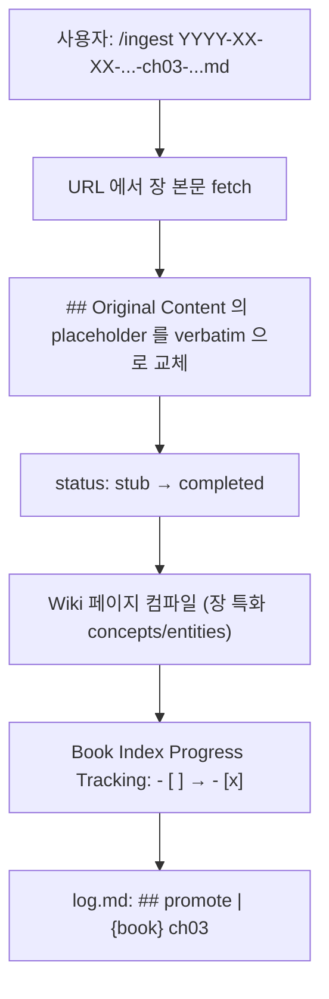

# Book Ingest Pattern

> [!tip] Key Insight
> **멀티 페이지 책을 한꺼번에 컴파일하지 않는 로컬 운영 선택지**다. TOC와 서문으로 navigable scaffold(1 Book Index + N stubs)를 만들고, 사용자가 실제로 읽기로 선택한 장만 원문 보존과 Wiki 컴파일 단계로 승격한다.

---

## Overview

**Book Ingest Pattern** 은 표준 `/ingest` 의 **변형 (variant)** 이다. 단일 URL/파일/텍스트용 표준 모드와 달리, 멀티 페이지 책·문서 사이트 (mdBook, VitePress, GitBook, Docusaurus, ReadTheDocs, Nextra — TOC 에 5+ 챕터) 를 대상으로 설계됨.

가설: 30장짜리 책을 표준 `/ingest`로 한 번에 처리하면 다음 문제가 생길 수 있다.
1. **한 파일에 전부** — 100K+ words, 가독성 붕괴, `## Original Content` 이 비대화
2. **30 파일 동시 ingest + 30 × Wiki 컴파일** — 아직 검토하지 않은 AI 요약이 Wiki에 대량 삽입되어 출처와 사용자 이해의 경계가 흐려질 수 있음

후보 해법은 **Progressive Stubs**다. navigable scaffold만 먼저 만들고, 필요한 장을 chapter-by-chapter 승격한다. 실제 토큰 절감·독서 완주율·오류 감소 효과는 아직 이 저장소의 사용 사례로 검증되지 않았다.

---

## Architecture

### Scaffold 단계 (지금)

```
10. Raw Sources/11. Articles/
├── YYYY-MM-DD-{author}-{book}-book-index.md       ← Book Index (verbatim preface)
├── YYYY-MM-DD-{author}-{book}-ch01-{slug}.md      ← stub
├── YYYY-MM-DD-{author}-{book}-ch02-{slug}.md      ← stub
├── ...
└── YYYY-MM-DD-{author}-{book}-ch{N}-{slug}.md     ← stub

20. Wiki/22. Entities/
├── {Book Title (native)}.md                        ← 책 자체
└── {Author Name}.md                                ← 저자

20. Wiki/21. Concepts/
└── {Anchor Concept from Preface}.md                ← 저자가 preface 에서 명시한 앵커 (선택)
```

**Book Index 내용**:
- Preface verbatim in `## Original Content`
- `## TOC` — N장 link table (편/파트로 그룹)
- `## Reading Paths` — 저자가 제시한 경로 (있으면) verbatim
- `## Progress Tracking` — `| Ch | Title | Status | Read on |` 테이블

**Chapter stub 내용**:
- Frontmatter: `status: stub`, `chapterNumber`, `chapterPart`, `bookIndex`, `chapterPrev`, `chapterNext`
- `## Source` — 원본 URL + 책 링크 + 이전/다음 장
- `## TOC Preview` — TOC 한 줄 요약 verbatim
- `## Original Content` — **placeholder block** (비어있지 않음, hook 통과용)
- `## Reading Notes` — 독서 중 메모 공간

### 승격 단계 (사용자 독서 시)

사용자가 `ch3` 을 읽을 때:



승격은 **개별 발생**. 사용자는 모든 장을 꼭 다 읽을 필요 없음 — 책의 3 장만 중요하면 3 장만 승격되고 나머지는 영구 stub 유지.

---

## Frontmatter Keys

Book Ingest 가 도입한 신규 frontmatter 키 (camelCase 준수):

| Key | 타입 | 용도 |
|-----|------|------|
| `status: stub \| reading \| completed \| ingested` | enum | 독서·컴파일 진행 상태 |
| `bookIndex` | wikilink | 소속 Book Index Raw Source |
| `chapterNumber` | int | TOC 기준 챕터 번호 |
| `chapterPart` | string | 편/파트 이름 (원문 언어 보존) |
| `chapterPrev` | wikilink\|null | 이전 챕터 |
| `chapterNext` | wikilink\|null | 다음 챕터 |

실행 기준은 `.codex/commands/ingest.md`의 `Book Ingest Mode`와 `.codex/hooks/validate-raw-source.sh`를 따른다.

---

## Status Lifecycle

```
stub  →  reading  →  completed
```

- **`stub`** — scaffold 생성 직후. `## Original Content` 에 placeholder. Wiki 에 이 장 전용 페이지 없음.
- **`reading`** — 사용자가 장을 읽기 시작 (선택적 중간 상태). Reading Notes 에 메모 추가 중.
- **`completed`** — 본문 verbatim + Wiki 컴파일 완료. Book Index Progress 에서 체크.
- **`ingested`** — 위 lifecycle과 별개인 표준 ingest Raw Source의 완료 상태.

---

## 언제 Book Ingest 를 쓰는가

### ✅ 적합

- 명시적 TOC 를 가진 기술서 (mdBook, GitBook, VitePress 사이트)
- 5 장 이상의 구조화된 문서 (API reference, tutorial series)
- 저자가 "reading paths" 를 제시한 책 — 비선형 독서 지원
- 내가 **전체를 다 읽지 않을 수 있는** 긴 자료

### ❌ 부적합

- 단일 긴 에세이 (preamble 없이 chapter 없는 long-form) → 표준 ingest
- 학술 논문 (paper) → 표준 ingest (논문은 원래 단일 단위)
- 짧은 블로그 포스트 시리즈 (독립 포스트들) → 각각 표준 ingest
- 코드 저장소 (`src/` 분석) → 표준 ingest + 필요 시 파일별 분리 ingest

---

## 관련 원칙

### Progressive Disclosure와의 유사성

Book Ingest는 **TOC preview → selected full chapter** 순서로 정보를 늦게 확장한다는 점에서 progressive disclosure와 유사하다. 이는 이 저장소가 채택한 설계 비유이지 외부 원문의 명시적 요구사항은 아니다.

### Contamination Mitigation 과의 정렬

LLM이 사용자가 검토하지 않은 장을 요약해 Wiki에 대량 반영하면 **원문·AI 해석·사용자 이해의 경계**가 흐려질 수 있다. Stub은 장별 Wiki 생성을 보류하지만, 사용자가 실제로 이해했음을 자동 보장하지는 않는다.

### [[LLM Wiki Pattern]]의 로컬 확장

Karpathy 원문은 raw 자료를 모아 LLM이 Wiki로 점진 컴파일하고, 유용한 질의 결과를 다시 Wiki에 축적하는 패턴을 설명한다. 그러나 "스크랩할 때가 아니라 읽을 때 컴파일한다"거나 chapter stub 방식을 사용하라는 원칙은 원문에 없다. Book Ingest는 그 패턴 위에 이 저장소가 추가한 prescriptive workflow다.

---

## Hook Interaction

- `.codex/hooks/validate-raw-source.sh`는 모든 Markdown Raw Source에 `## Original Content` heading을 요구한다.
- 일반 Raw Source는 20줄 이상의 non-empty body도 검사한다.
- `status: stub`은 heading을 유지하되 body 길이 검사에서 명시적으로 제외된다. 승격 시 placeholder를 실제 원문으로 교체해야 한다.

> [!note] Bias Check
> 이 패턴은 실제 책 인제스트 결과에서 귀납한 표준이 아니라 저장소 유지자가 설계하고 harness에 구현한 운영 가설이다. Stub이 토큰 비용, 오염 위험, 독서 품질을 개선한다는 비교 데이터는 없다. 또한 원문 저작권·접근 권한·재배포 조건은 별도로 확인해야 하며, 공개 URL이 있다는 사실만으로 전문 저장이 허용되는 것은 아니다.

---

## Related

- [[LLM Wiki Pattern]] — raw-to-Wiki 점진 컴파일이라는 기반 패턴
- [[Ingest-Query-Lint Cycle]] — Book Ingest 는 Ingest 의 variant
- [[3-Layer Architecture]] — Raw Sources 레이어 내부 구조 다양화

---

## Open Questions

> [!question] Stub 의 수명 정책
> 1 년 이상 읽지 않은 stub 은 어떻게 처리하나? 자동 archive? `/lint` 에 "stale stub" 검사 추가 필요.

> [!question] Stub 삭제 vs Wiki 역링크
> 사용자가 stub 을 지웠는데 Book Index 와 다른 stub 의 `chapterPrev`/`chapterNext` 가 깨진다. Lint 에서 자동 복구 가능한지.

> [!question] Multi-language book 처리
> 같은 책이 여러 언어 판을 가진 경우 (예: 중국어 원문 + 영어 번역) 같은 Book Index 에 두 언어 TOC 를 나란히? 별도 Book Index 2 개?

---

## Sources

- [[2026-04-02-Karpathy-LLM-Knowledge-Bases-X-Thread]]
- [.codex/commands/ingest.md](../../.codex/commands/ingest.md)
- [.codex/hooks/validate-raw-source.sh](../../.codex/hooks/validate-raw-source.sh)
- [CHANGELOG.md](../../CHANGELOG.md)
