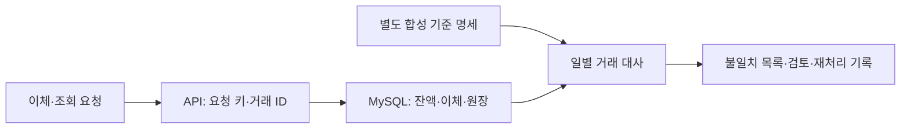
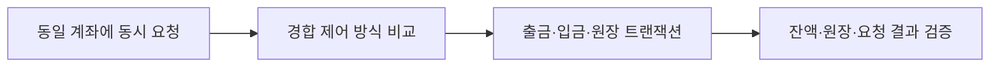
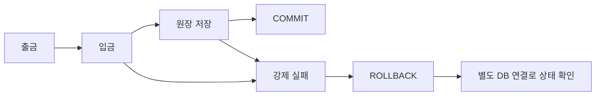
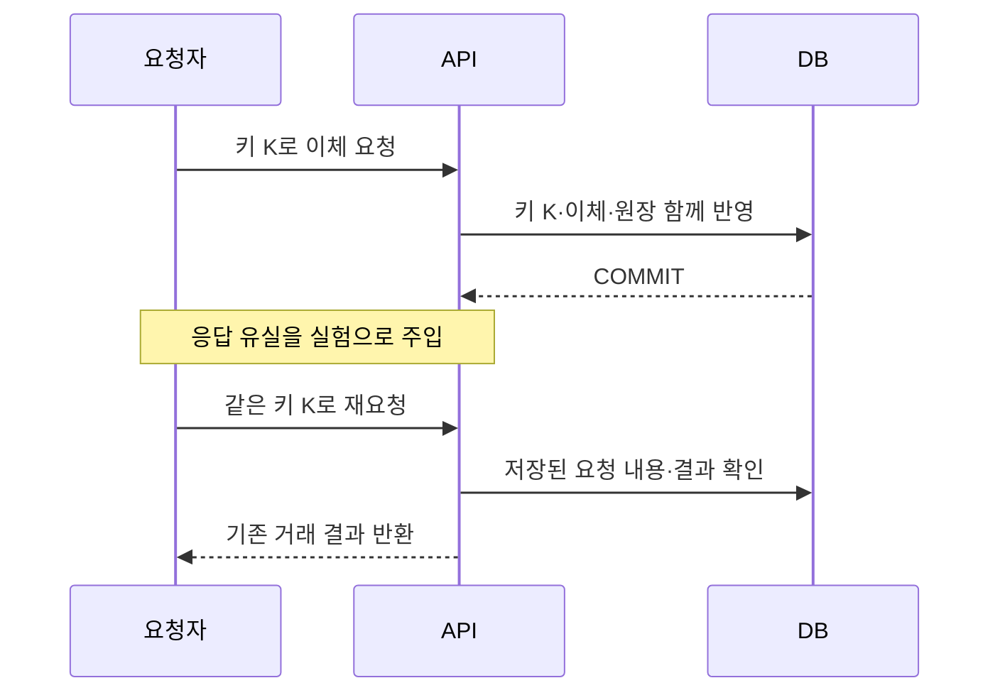
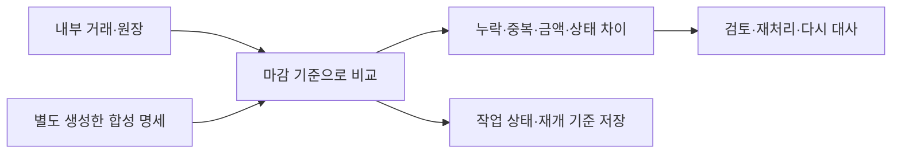
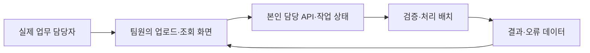
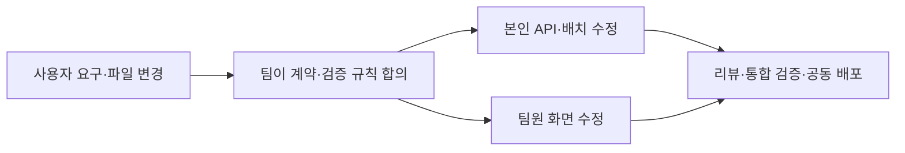

# 김규태 | 금융 백엔드 포트폴리오 — 이상형 제작본

> **상세 기록용 기준안.** 2026-10-06부터 제출본은 개인 1개 + 협업 1개, 총 2개 프로젝트를 2쪽 이내로 편집한다. 아래의 여러 '쪽'은 상세 사례를 정리한 최초 구성으로, 새 제출 분량을 뜻하지 않는다. 현재 편집 원고는 [금융 백엔드 포트폴리오 2쪽 원고](../70.%20Outputs/2026-10-06-Financial-Portfolio/금융%20백엔드%20포트폴리오%202쪽%20원고.md), 개발 기준은 [[2026-10-06-Q-two-page-financial-portfolio-k6-and-domain-rules]]를 따른다.

> **기획용 초안.** 아래 사례는 앞으로 구현·검증할 목표다. `[실측]`, `[확정]`, `[링크]`를 실제 증거로 채우기 전에는 성과로 제출하지 않는다. 현재 financial-lab의 완료 상태를 나타내는 문서가 아니다.

## 제작 원칙과 마지막 모호점 점검

후속 논의의 추천안은 [[2026-10-01-Q-financial-portfolio-integration-reconciliation-and-review]]에 정리했다. 내부 원장에 별도 모의 기관 연동·대사를 추가하는 것은 아직 사용자 선택 전 제안이다. 사용자는 협업에서 팀장을 원하며, 추천 역할은 팀장 + 핵심 백엔드 모듈 책임자다. 아래 최초 제작본의 범위를 실제 외부 기관 연동 완료로 해석하지 않는다.

코딩웨일의 이상형 선설계 절차를 사용하고, 생각등대의 **제목 → 그림 → 문제 → 해결 → 결과** 순서를 모든 사례에 반복한다. 문제는 약 3줄, 해결은 약 3~4줄로 요약한다. 자세한 재현·대안·한계는 연결한 기술 문서에서 설명한다. 그림은 아래의 기획 스케치를 사용자가 실제 구현에 맞춰 수정하고 직접 설명해야 한다.

| 항목       | 이번 제작본의 처리                                | 제출 전 확정할 것                          |
| -------- | ----------------------------------------- | ----------------------------------- |
| 지원 방향    | 여의도 금융권 신입 백엔드. 주문/FEP/OMS로 한정하지 않음       | 지원 공고별 역할에 맞춰 표지·사례 강조 조정           |
| 프로젝트 수   | 개인 금융 프로젝트 1개 + 협업 프로젝트 1개                | 협업 주제·팀·사용자 선택                      |
| 개인 업무 경계 | 동일 서비스의 원화 계좌이체·원장·일별 거래 대사를 제안           | 사용자 확인. 실제 외부 송금·청산 포함 여부           |
| 대사 자료    | 내부 기록과 별도 합성 명세 비교를 제안                    | 명세 생성 규칙·독립성·마감 기준·늦은 거래 처리         |
| 운영 규모    | 사용자가 수용한 부하·사양 가정 유지                      | 실제 환경·비용·성능·복구 검증                   |
| 기술 선택    | Java/Spring/MySQL 기반 후보. 락·배치 방식은 비교 후 선택 | 버전·최종 방식·선택 근거                      |
| 성과·기여    | 목표와 빈칸으로 작성                               | 직접 구현한 코드·판단·AI 도움·실측               |
| 협업 사례    | 이상적인 상황을 제시                               | 실제 발생한 문제로 교체. 미리 정한 실패를 경험으로 쓰지 않음 |
| 마지막 페이지  | 보류한 보조 페이지로 표시                            | 사용자가 나중에 제공할 영상·학력/자격 증빙            |

제작을 막는 미정 사항은 없다. 업무 범위는 제안 상태이고, 실측·팀 경험은 구현 후 채운다. 채용 성공을 보장하는 문서로 해석하지 않는다.

---

## 1쪽 — 소개와 핵심 경험

# 김규태 | 금융 데이터의 정확성과 복구 과정을 설명하는 백엔드 개발자

계좌이체의 동시 요청, 부분 실패, 응답 유실을 재현하고 잔액과 원장으로 결과를 검증하는 백엔드를 목표로 합니다. 데이터 처리 과정과 장애 복구를 코드·SQL·실험 기록으로 설명하고, 팀에서는 요구사항과 API 계약을 합의해 서비스를 완성합니다.

- **개인 프로젝트:** 계좌이체·거래 원장·일별 대사 — 거래 정확성, SQL, 재시도와 복구.
- **협업 프로젝트:** 업무 데이터 검증·리포트 서비스 `[후보]` — 본인 백엔드 구현, 리뷰·통합·공동 배포.
- **핵심 기술:** `[실제 사용·설명 가능한 Java / Spring / SQL / MySQL / 배포 기술만 기입]`
- **GitHub:** https://github.com/gyutaetae
- **대표 글:** 응답이 끊겨도 계좌이체는 한 번만 — 거래 원장과 멱등성을 검증한 과정 `[직접 글 링크]`
- **연락처:** 010-5405-6636

이 소개 문단도 목표 상태의 문장이다. 실제 제출 시 경험이 있는 표현으로 수정한다.

---

## 2쪽 — 개인 프로젝트 개요

# Reliable Bank Transfer Ledger Lab

**서비스:** 계좌 사이의 이체를 처리하고, 거래별 원장을 남겨 결과를 추적하며, 일별 명세와 내부 기록의 불일치를 확인하는 금융 백엔드.

- **기간:** `[실제 시작일 ~ 종료일]`
- **참여:** 개인 프로젝트 / 본인 설계·핵심 구현·SQL·검증 `[실제 기여로 확정]`
- **기술:** Java, Spring Boot, MySQL `[후보 / 사용 버전 확정]`
- **링크:** `[저장소·고정 release]` · `[시연]` · `[대표 기술 글]`
- **예상 트래픽·초기 인프라(가정):** 10만 DAU·30만 이체/일·조회:이체 5:1·피크 15배(313 API RPS/52 이체 TPS)를 기준으로 API 3대(각 2 vCPU/4 GiB)와 MySQL Primary/Standby(각 8 vCPU/32 GiB SSD)를 산정하고 k6로 검증한다.

**업무 규칙:** 금액은 원화 정수 단위로 저장하고 잔액은 음수가 되지 않게 한다. 이체 완료 시 출금·입금·원장을 함께 반영한다. 완료 거래의 양쪽 원장 금액이 균형을 이루며, 계좌 잔액은 초기 잔액과 거래 기록으로 검증할 수 있게 한다. 같은 요청 키의 동일 요청은 중복 반영하지 않고, 내용이 다르면 충돌로 처리한다.

**적용 범위:** 내부 계좌이체와 거래 대사에 대한 제안이다. 합성 명세를 실제 금융기관 연동 자료로 표현하지 않는다. DB 대기 서버의 존재만으로 무손실 복구를 주장하지 않으며 장애 실험 결과를 별도로 제시한다.

---

## 3쪽 — 동시 출금에서 잔액과 거래 기록이 어긋나는 문제

**문제 — 재현할 상황**

- 동일 계좌에 여러 요청을 보내 잔액 확인과 갱신 사이의 경쟁을 재현한다.
- 성공 응답과 최종 잔액·원장 사이의 불일치를 검증 SQL로 확인한다.
- 계좌 집중도가 높은 조건에서도 돈의 보존과 응답 지연을 함께 평가한다.

**해결 — 비교·선택 계획**

- 조건부 UPDATE, 낙관적 락, 비관적 락을 동일한 요청 분포에서 비교한다.
- 계좌 접근 순서와 트랜잭션 범위를 정의하고 교착·충돌·잔액 부족을 구분한다.
- 잔액과 원장을 함께 검증한 뒤 정확성과 재시도·대기 비용을 근거로 `[선택 방식]`을 결정한다.

**결과 — 실험 후 기입**

| 조건 | 개선 전 | 개선 후 |
|---|---|---|
| 잔액·원장 불일치 | `[실측 건수]` | `[실측 건수]` |
| 유효 이체 TPS / p99 | `[실측]` | `[실측]` |
| 락 대기·교착·충돌 | `[실측]` | `[실측]` |

조건: `[API/DB 사양·버전, 계좌 수, 초기 잔액, 금액, 동시성, 집중도, 기간, 반복 횟수]`。한계: `[집중 계좌에서 처리량이 줄어드는 조건 등]`。근거: `[코드·SQL·측정 원본]`。

---

## 4쪽 — 출금 후 실패했을 때 부분 반영이 남는 문제

**문제 — 재현할 상황**

- 출금·입금·원장 저장 사이에 예외를 주입해 부분 반영 여부를 확인한다.
- API의 실패 응답만으로 데이터가 복구됐다고 판단하지 않고 DB 상태를 조회한다.
- 잔액과 거래 기록 중 한쪽만 남으면 거래를 추적하고 복구하기 어려워진다.

**해결 — 비교·선택 계획**

- 각 단계의 개별 반영과 하나의 DB 트랜잭션으로 묶은 구조를 비교한다.
- 트랜잭션 경계·예외 전파·롤백 조건을 확인하고 단계별 실패를 재현한다.
- 별도 연결의 검증 SQL로 출금·입금·원장이 함께 반영되거나 취소되는지 확인한다.

**결과 — 실험 후 기입**

부분 반영 `[개선 전 실측] → [개선 후 실측]`, 단계별 실패 표본 `[실측]`, 거래 불일치 `[실측]`。

조건: `[DB 버전·격리 수준·실패 위치·표본 수]`。한계: DB 트랜잭션 밖의 통신·외부 효과까지 자동으로 되돌아가는 것으로 설명하지 않는다. 근거: `[실패 테스트·최종 상태 SQL·commit]`。

---

## 5쪽 — 완료된 이체의 응답 유실 후 재요청이 중복 반영되는 문제

**문제 — 재현할 상황**

- DB 반영은 완료됐지만 응답이 도착하지 않은 상황을 재현한다.
- 재요청을 새로운 이체로 처리하면 사용자의 돈이 중복으로 이동할 수 있다.
- 순차 재시도뿐 아니라 같은 키의 동시 요청·서로 다른 내용도 검증한다.

**해결 — 비교·선택 계획**

- 조회 후 저장 방식과 DB 유일성 제약·트랜잭션으로 처리하는 방식을 비교한다.
- 요청 키의 범위, 요청 내용 비교, 충돌 처리, 보관 기간을 정의한다.
- 기존 거래 결과 조회와 재요청 처리를 연결하고 앱 재시작 후에도 검증한다.

**결과 — 실험 후 기입**

동일 키 요청 `[실측 횟수]`건에 유효 이체 `[실측]`건, 동시 중복 반영 `[전 → 후]`, 내용 충돌 처리 `[실측]`。

조건: `[순차·동시 요청 수, 응답 유실 위치, 재시작 여부, 키 범위·보관 정책]`。한계: 키가 다른 요청과 키 보관 종료 후의 요청은 별도 정책이 필요하다. 근거: `[대표 글 직접 링크·실험 명령·DB 기록]`。

---

## 6쪽 — 일별 대사에서 불일치와 중단 후 처리 누락을 확인하는 문제

**문제 — 재현할 상황**

- 정상 거래 외에 누락·중복·금액·상태 차이를 가진 합성 표본을 준비한다.
- 거래량 증가에 따른 SQL 비용과 배치 중단 후 처리 누락·중복을 확인한다.
- 불일치를 발견한 뒤 원인과 복구 결과를 추적할 수 있어야 한다.

**해결 — 비교·선택 계획**

- 명세 생성 규칙과 마감 시점을 정의하고 정답 표본과 탐지 결과를 비교한다.
- 조회 방식·인덱스·처리 단위를 EXPLAIN과 실행 시간으로 비교한다.
- 작업 상태와 재개 기준을 저장하고 중단·재시작·중복 실행을 검증한다.
- 불일치 유형별 검토·재처리 규칙을 문서화하고 결과를 다시 대사한다.

**결과 — 실험 후 기입**

정답 오류 `[실측]`건 / 탐지 `[실측]`건 / 오탐 `[실측]`건, 처리 시간 `[전 → 후]`, 중단 후 누락·중복 `[실측]`。

조건: `[데이터량·오류 분포·DB 사양·인덱스·실행 계획·청크 크기·중단 위치]`。한계: 합성 자료로 검증한 범위를 명시하고 실제 기관 대사·자금 지급 경험으로 표현하지 않는다. 근거: `[SQL·정답 표본·재개 로그·복구 절차]`。

---

## 7쪽 — 협업 프로젝트 개요

# 업무 데이터 검증·리포트 서비스 `[이상형 후보]`

**서비스:** 실제 조직의 담당자가 파일을 올리면 데이터 오류를 확인하고 처리 결과와 보고서를 조회하는 서비스. 대상 조직·업무·사용자는 선정 전이다.

- **기간·팀:** `[확정]` / `[역할별 실제 구성]`
- **본인 책임:** 데이터 모델·작업 상태 API·검증 배치·조회 SQL 중 `[맡은 모듈 확정]`
- **협업:** 화면/분석/서버 담당자와 API 계약, PR 리뷰, 통합과 공동 배포.
- **운영 규모:** `[실제 사용자와 업무량 조사 후 가정·실측을 구분해 기입]`
- **링크:** `[저장소·담당 PR·서비스·사용자 피드백]`

---

## 8쪽 — 파일 형식 변경으로 화면과 배치의 계약이 어긋나는 문제 `[사례 후보]`

**문제 — 경험이 생긴 뒤 교체**

- `[사용자 요청이나 통합 과정에서 실제 발견한 현상]`
- `[화면·API·배치 사이의 원인과 사용자 영향]`
- `[본인이 책임지고 해결할 범위]`

**해결 — 목표 경험**

- 사용자와 필수 항목·오류 처리 기준을 확인하고 팀원과 API 계약을 합의한다.
- 본인 모듈을 직접 수정하고 리뷰에서 바뀐 판단과 코드를 남긴다.
- 팀원의 기능과 통합해 배포하고 실제 사용자 피드백을 반영한다.

**결과 — 경험·측정 후 기입**

업무 처리 시간 `[전 → 후]`, 재작업·오류 `[전 → 후]`, 본인 기여 `[PR·코드]`, 팀 합의·리뷰 `[기록]`。

조건: `[실제 사용자 수·업무 표본·관찰 기간]`。한계: `[팀 전체 결과와 본인 책임 구분]`。근거: `[담당 PR·합의 기록·릴리스·피드백]`。

이 사례를 반드시 만들려고 문제를 꾸미지 않는다. 실제 경험이 조회 지연·작업 중단·요구사항 변경이었다면 같은 서술 형식으로 교체한다.

---

## 보조 페이지 — 확인 후 작성

학력·관련 경험·자격·어학·수상/교육 활동의 확인된 사실만 넣는다. 사용자가 영상 자료를 제공하면 배치를 다시 검토한다. 직무 관련 인턴의 강한 문제 해결 경험이 생기면 본문에 올릴 수 있다.

## 제출 전 확인과 상세 자료 연결

- 현재는 개인 4개 + 협업 1개, 총 5개 사례의 이상형이다. 생각등대의 '약 네 블록'은 권장 규모로 해석했다. 지원처 분량이 짧으면 개인 3개 + 협업 1개를 본문에 두고 원자성 세부 사례를 상세 문서로 연결한다.
- 결과의 수치·조건·그래프·링크를 실제 실행 근거로 채운다. 목표 처리량을 달성 TPS로 바꾸지 않는다.
- 그림을 실제 구현에 맞춰 직접 검토하고 각 화살표와 실패 분기를 설명한다.
- 저장소에 고정 release, README, 업무 규칙, ERD, 테스트·SQL·합성 데이터·실험 명령, 측정 원본, 복구 절차, 짧은 시연을 연결한다.
- 대표 글 한 편에는 문제·대안과 선택 이유·재현 방법·동일 조건의 전후 결과·한계를 함께 담는다.
- AI의 도움과 본인의 구현·판단·검증 범위를 실제 기록으로 명시한다.
- 현업 검토에서는 사례의 깊이·읽는 속도·업무 경계·조건부 수치의 신뢰성을 확인받고, 그 뒤 현실 범위를 조정한다.

> [!note] Bias Check
> 이 문서는 두 영상과 기존 레퍼런스 분석을 활용한 기획이다. 합격자들의 장점을 모두 확보했다는 검증이나 취업 보장이 아니다. 그림·문제 상황·결과 항목은 제안이며 실제 경험과 측정으로 바꿔야 한다. 협업 주제·개인 업무 경계·마지막 페이지는 확정되지 않았다.

이 답변은 포트폴리오 제작과 프로젝트 완료 기준에 활용 가능합니다 — 이상형을 실제 제출 문장의 구조로 작성하고 남은 판단·구현·측정 항목을 드러냅니다.
