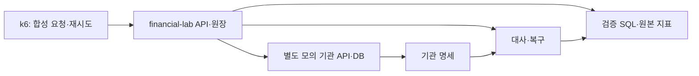

# 프로젝트 2개·제출 2쪽·k6와 금융 업무 규칙

## 이번 사용자 결정

- 대표 프로젝트는 개인 금융 서비스 1개와 협업 서비스 1개다. 네 금융 사례는 개인 프로젝트 안의 문제 해결 경험이다.
- 제출본은 2쪽 이내를 목표로 편집한다. 기존 8쪽 구성은 상세 기록으로 유지한다.
- 실제 기관 협력에 의존하지 않고 k6 합성 요청과 별도 모의 기관으로 검증한다.
- 거래 대사와 복구를 개발 중심에 둔다. 정산 계산·실자금 결제를 구현한 것으로 확장하지 않는다.
- 도메인 규칙은 특정 지급망의 공식 근거와 자체 설계 정책을 구분한다.
- 연구실 요청은 잘못 입력한 맥락이므로 관련 요청 자료·문안을 삭제했다.

## 영상 기준과 프로젝트 수 점검

보유한 생각등대 영상 원문은 약 네 개의 문제 해결 블록을 권한다(1:07, 6:21, 8:09). 프로젝트 2~3개나 전체 문서 2쪽이라는 조건은 해당 원문에서 확인되지 않았다. 웹 검색으로도 해당 발언의 직접 출처는 확보하지 못했다. 사용자 기억을 영상의 확정 발언으로 인용하지 않는다.

사용자의 분량 선호를 적용해 **프로젝트 2개·제출본 2쪽**으로 편집한다. 개인 프로젝트의 네 사례를 본문에서는 정확성/재시도와 대사/복구 두 블록으로 묶고, 협업 사례 한 블록을 둔다. 상세 문서에서는 네 사례의 실패 재현·대안·결과를 모두 보존한다. 약 네 블록을 의무 수량으로 해석하지 않는다.

2쪽 편집 원고: `70. Outputs/2026-10-06-Financial-Portfolio/금융 백엔드 포트폴리오 2쪽 원고.md`. 실제 PDF 페이지 수는 아직 렌더링으로 확인하지 않았다. 새로운 파일은 편집 원고이며 완료 성과가 아니다.

## k6와 모의 기관의 역할

k6는 요청을 생성하고 응답과 지연을 측정한다. 모의 기관은 요청 키별 처리·별도 기록·결과 조회·명세 생성·응답 유실/지연 조건을 제공한다. 실패 주입과 프로세스 중단은 모의 기관 설정 또는 별도 실험 제어로 수행한다. k6만으로 외부 기관 업무나 DB 정확성이 자동 검증되지는 않는다.

constant-arrival-rate는 응답 속도와 독립적으로 iteration 시작률을 설정한다. iteration 안의 요청 수에 따라 HTTP 요청률은 달라진다. [공식 executor 설명](https://grafana.com/docs/k6/latest/using-k6/scenarios/executors/constant-arrival-rate/)

가정 피크의 근사 실험은 이체 52 iteration/s와 조회 260 iteration/s를 별도 시나리오로 두고 각 iteration에 한 요청을 넣어 312 RPS를 목표로 한다. 기존 개요의 313 RPS는 반올림한 규모 가정이며, 필요하면 6초간 이체 313건·조회 1,565건으로 313 RPS의 비율을 표현한다. 재시도·상태 조회·인증 요청이 추가되면 전체 RPS가 늘어나는 것을 따로 기록한다.

부하 생성기가 실제 목표를 공급했는지 dropped_iterations·VU·CPU를 확인한다. 지속 부하·점증 부하·특정 계좌 집중·중복 재시도·모의 기관 장애·대사 동시 실행을 나눠 측정한다. 모든 실험에 정상 거래 입력과 잔액 부족 등 예상 거절 입력을 구분한다.

정확성은 실험 후 잔액·원장·기관 기록을 SQL로 검증한다. 유효 이체 TPS, p95/p99, 예상 밖 오류, 락 대기, DB 사용량, 대사 탐지/오탐/미탐, 복구 후 누락/중복을 기록한다. threshold로 실험 통과 기준을 설정할 수 있지만 성능 목표 값은 업무 목표로 결정한다. checks만으로 k6 실행을 실패 처리하는 것은 아니므로 필요한 threshold를 함께 정의한다. [공식 thresholds 설명](https://grafana.com/docs/k6/latest/using-k6/thresholds/)

## 실제 금융 업무를 닮게 만드는 기준

전체 업계에 동일한 명세 마감 시간이 있다는 전제를 사용하지 않는다. 전자금융공동망을 통한 타행 계좌이체를 참고할 업무 모델로 추천한다. 이는 지원 직무를 타행환으로 한정한다는 뜻이 아니다.

한국은행은 소액지급시스템의 개인/기업 이체와 은행 간 최종 결제를 구분한다. 금융결제원은 지급지시 확인·중계와 차액정산 등을 담당하고, 은행 간 채권·채무는 한은금융망 결제로 해소된다. [지급결제제도 설명](https://www.bok.or.kr/portal/main/contents.do?menuNo=200347)

한국은행 2025년 4월 강좌는 고객 계좌의 즉시 반영과 다음 영업일 오전 11시의 기관 간 이연차액결제를 설명한다. **11시는 명세 파일 생성이나 거래 대사 마감이라는 뜻이 아니다.** 해당 자료 시점과 업무 범위의 참고 근거로 사용한다. [제996회 공식 강좌](https://www.bok.or.kr/portal/bbs/B0000217/view.do?nttId=10091239&menuNo=200144&programType=multiCont&relate=Y&depth=200144)

금융결제원 전자금융업무 안내는 연중무휴 24시간 서비스와 은행의 자정 전후 마감처리시간 예외를 설명한다. 모든 은행의 정확한 중단 시간이나 일별 데이터 귀속 규칙이 동일하다고 일반화하지 않는다. [전자금융업무 안내](https://community.kftc.or.kr/kftc/business/BusinessFncJoin.do)

| 구현할 개념 | 근거/수준 | 적용 |
|---|---|---|
| 고객 거래와 기관 간 결제 상태 구분 | 공식 지급결제 설명 | 고객 거래 완료와 기관 간 예정/완료 상태를 별도 의미로 관리 |
| 다음 영업일·영업일 캘린더 | 공식 강좌의 업무 모델 | 주말·휴일을 건너뛰는 날짜 계산 검증 |
| 자정 전후 가용성 변화 | 공식 서비스 안내 | 기관별 유지보수 구간을 설정으로 주입 |
| 명세 귀속·생성 시간 | 상세 운영 규칙 미확보 | 기관 프로파일의 프로젝트 정책으로 명시 |
| 미결·누락·수정 명세·재개 | 자체 복구 설계 | 발생 조건·상태·기대 결과와 재대사 검증 |

앞서 제안한 명세 01:00 생성·01:10 대사 실행은 자체 예시였으며 공식 마감이 아니다. 프로젝트 기준으로 고정하기 전에 선택한 지급망의 공개 규정과 API 명세에서 추가 확인한다. 공개된 교육 자료만으로 실제 기관 내부의 명세 배치 시각·정정 규칙·휴일별 거래 묶음 규칙을 모두 알 수는 없다.

개발에서는 거래 접수/처리 시각, 거래 업무일, 명세 기준일·버전, 기관 간 결제 예정일을 분리한다. 완료·거절·결과 미확정을 구분하고, 과거 명세 수정은 이력으로 남긴다. 예상 결제일 관리까지 구현해도 실제 청산·자금 결제를 수행한 경험으로 표현하지 않는다.

경계 검증: 자정 직전/직후, 주말·공휴일, 유지보수 중 요청, 기관 완료 후 응답 유실, 지연 명세, 금액 차이, 수정 명세 재대사, 배치 중단·재개. 날짜 계산은 주입한 시계·캘린더로 재현하고 실시간 부하 실험과 구분한다.

포트폴리오 문장 목표: '국내 소액지급시스템의 고객 거래와 기관 간 결제 구분을 참고해 모의 기관 연동을 설계하고, 영업일·미결·지연 명세·재실행 조건에서 거래 대사와 복구를 검증했다.' 실제 검증 이후에 사용한다.

> [!note] Bias Check
> 영상의 프로젝트 2~3개·2쪽 발언은 확인되지 않았다. 2쪽은 사용자 편집 기준이다. 부하와 모의 기관의 장애 분포는 합성 조건이다. 공식 결제 시점을 명세 마감으로 해석하지 않으며 공개 근거가 없는 운영 정책을 업계 표준으로 주장하지 않는다.

이 답변은 포트폴리오 제출과 금융 업무 구현에 활용 가능합니다 — 프로젝트 수·문서 분량을 정리하고 합성 실험과 실제 업무 근거를 연결합니다.
