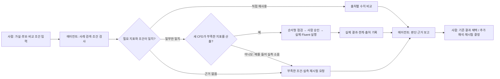

# Rotor Engineering Knowledge Agent — PRD

작성일: 2026-09-25
최근 검토: 2026-09-27
상태: 팀 합의·구현 기준안
제품 시연명: **Propeller Evidence Agent**

확정 데모(2026-09-27): **ENOLA XOAR 9×7의 ABS·PA12 제작 시제품 비교**, Resin은 참고 후보. 7350RPM·정적 조건·Mic1 기록을 시작점으로 사용한다. ‘미측정 8500RPM이나 새 형상에서도 같은 결론인가?’라는 후속 요청으로 증거 재사용과 승인형 CFD/실측 요청을 분기한다. 원본 음향 세 파일은 계산 검증했고, 물리 채널·교정·반복 실험 매핑은 부분 확인 상태다. [음향 검토·처리 방법·계산 결과](ENOLA%20음향%20검토와%20확정%20데모%20조건.md).

정확한 표현은 **재료·제작 방식 변경**이다. 재료만의 인과효과를 주장하지 않는다. 강체 유동 모델의 재료 라벨만 바꿔 제작품의 탄성·거칠기·소음 차이를 검증했다고 주장하지 않으며, Fluent는 승인된 형상/운전 조건에서 확인 가능한 공력 지표만 실행한다.

> **한 문장 제품 정의:** 프로펠러 제작 재료·공법 변경 후, 품질 엔지니어가 시제품의 요구 추력과 소음·토크 제약 충족 여부를 검토하도록 돕는 에이전트. 기존 시험 근거를 비교하고, 부족한 항목은 추가 해석·시험으로 구분해 후보를 다음 검토 단계에 올릴지 판단할 근거를 만든다.

## 1. 문제와 제품 방향

품질 엔지니어는 성능·소음 개선을 위해 제작 재료·공법을 바꾼 시제품 B를 시험한 뒤, “B가 요구 추력을 충족하면서 소음·토크 제약도 만족하는가?”를 검토한다. 과거 시험·해석 기록에서 비교 근거를 찾고 조건을 확인하며 부족한 증거를 식별하는 업무를 지원한다. 기록 분산·반복 검토 부담의 실제 빈도와 정도는 인터뷰로 확인할 문제 가설이다. 새 CFD를 수행할 때는 형상 버전, 단위, 격자 품질, 경계조건, 솔버 설정과 수렴 상태를 점검한다.

우리의 MVP는 **제작된 프로펠러 시제품의 시험·재시험 판단을 돕는 에이전트**다. 소음은 검토 지표, 사례 기록은 판단 근거, CFD 자동화는 부족한 증거를 보충하는 수단이다. 사람이 정한 가설과 비교 기준을 근거에 비추어 검토한다. 실행 하네스는 추가 CFD가 필요할 때 승인된 작업을 수행하고 과정을 보여준다. 에이전트는 새 형상의 물리적 타당성을 보장하거나 최적 프로펠러를 자동 발견하지 않는다.

### 핵심 사용자

- 1차 사용자: 제작품의 요구사항 충족 여부를 검토하는 **품질 엔지니어**(사용자 선택 완료; 인터뷰 결과는 아직 없음)
- 협업 사용자: CFD/설계 엔지니어, 시험 담당자, 기술 검토자
- 사용 시점: 대체 공법으로 시제품을 제작·시험한 뒤, 다음 제작·시험 단계로 진행하기 전.
- 사람의 최종 결정: **현재 근거로 후보를 다음 검토 단계에 올릴지 판단**. 부족하면 추가 해석·실측을 요청한다. 다음 검토 단계 진입은 제작 승인·출하 합격·비행 안전 인증과 다르다.
- 소음은 **제조 중 공장 소음**이 아니라 **제작된 프로펠러의 운용 소음**이다. 이 소음이 해당 팀의 우선 과제인지는 인터뷰와 실제 요구사항으로 검증해야 한다.

## 2. 이번 대회 MVP의 범위

### 다음 작업을 위한 결정 기록과 미결 사항

2026-09-27 사용자 합의가 이전의 일반적인 후보 최적화·형상 비교 설명보다 우선한다.

| 항목 | 결정·현재 상태 |
|---|---|
| 제조 변경 목적 | 성능·소음 개선. 비용·납기 개선을 주목적으로 내세우지 않음 |
| 대표 요청 | “ABS 제작품 A에서 PA12 제작품 B로 변경했다. 7350RPM 시험 근거로 요구 추력과 소음·토크 제약 충족 여부를 검토해줘.” |
| 결과 구조 | 요구사항별 `충족 / 미충족 / 판단 불가` + 별도 `A 대비 개선/악화` + 출처·조건·한계. 기준 충족과 상대적 개선은 서로 다른 판단 |
| 에이전트의 역할 | 요청 구조화 → 사례 검색 → 재사용 3단계 판정 → 규칙 기반 비교 → 추가 검증 분기 → 승인형 도구 실행 → 보고·사례 저장 |
| 데모 후속 질문 | “미측정 8500RPM이나 새 형상에서도 같은 결론인가?” 기존 결과를 확대하지 않고 출력 가능한 항목만 Fluent 실행 제안 |
| 확인된 환경 | 사용자 최신 보고(9/27): 시연할 Fluent 케이스 실행과 필요한 출력 지표 검증 완료. Windows Pro 사용. 검증 로그/세부 지표가 문서에 기록되지는 않았고, 제품 UI에서 승인 → 자동 호출 → 결과·DB 저장 E2E는 별도 구현·확인 필요 |
| 확인된 데이터 | ENOLA 7350RPM·Mic1 세 재료 음향 파일 계산 검증. 파일별 교정·채널 위치·반복 측정 매핑은 미완료. 음향 검토 보고서 참조 |
| 자문 가능성 | 품질 엔지니어 인터뷰 가능, 석박사 자문·검토 가능하다고 사용자 보고. 실제 인터뷰·검토 완료 또는 자료 제공 확정으로 표현하지 않음 |
| 성과 측정 | 총 경과 시간과 사람 개입 시간을 구분. 승인·오류 대응·최종 검토 포함. 사례 수·생략한 해석·불일치 발견·오판도 기록 |
| 제외 유지 | H200·GraphRAG·자동 최적화·FSI·복잡한 CAD·인증 보증. 임의 소음 예측이나 합성값으로 성능 입증하지 않음 |
| 미결: 판정 기준 | 요구 추력·소음 상한·토크 상한·허용 오차·불확실성 처리·CFD 대체 증거 인정 여부. 실제 기준 미확보 시 대회용 가상 요구사항임을 표시; 결과를 보고 기준을 맞추지 않음 |
| 일정 | 사용자 제공: 계획서 9/27, 결과물 10/6, 발표 10/12. 주제가 정해지면 바로 개발에 착수하기로 했으며, 현재 주제는 확정됨 |
| 역할 | 김규태: 팀장·에이전트/MCP/Fluent 연결·DB. 백창민: 비교 규칙·데이터/음향 처리, 비교표 UI 제안. 김석준: 전문가 소통·케이스/수동 CFD·결과 검토, 점검/진행 UI 제안. 추가 배분은 팀 확인 전 |
| 실제 구현 상태 | 사용자 최신 확인: Fluent Student 케이스 검증 완료. 단, 실제 에이전트·Streamlit UI·승인형 MCP 호출·DB 저장 흐름은 아직 구현 완료로 보고하지 않음 |
| 모델·예산 | 9/29 지원 안내 예정, 현재 API 없음. 개인 예산 1인 1만원 이내(팀 최대 약 3만원). 모델은 미정 |
| UI·실행 구조 | 결정: 처음부터 로컬 웹 화면으로 개발. Streamlit 최소 UI를 Windows Pro PC에서 실행하고 브라우저로 사용. CLI는 개발·디버깅용. 클라우드 호스팅 불필요; 선택할 LLM API는 원격 호출 가능 |
| 기준·자문 | 전문가 기준을 먼저 요청하고 미확보 시 가상 요구사항 표시. 다음 주부터 품질 절차·음향 검토 자문 가능, 완료 상태는 아님 |

**재개 순서:** 이 결정표 → `ENOLA 음향 검토와 확정 데모 조건.md` → 실제 코드/케이스 상태 확인 → 측정 메타데이터와 요구사항 확정 → 한 요청의 E2E 구현 → 세 분기 리허설 → 수작업 대비 평가. 임시 원본 파일은 `/tmp`에 있으므로 새 환경에서는 원본을 다시 확보하고 hash를 대조한다. 완료되지 않은 단계는 이전 답변만 보고 완료로 간주하지 않는다.

**개발계획서 작성 상태:** 사전 질문에 대한 사용자 답변을 반영해 [개발계획서 초안](개발계획서%20초안.md)을 작성했다. 사용자 결정에 따라 로컬 웹 UI로 확정했다. 추가 역할 배분은 제안이며, HWP 양식 페이지 제한은 옮긴 뒤 확인해야 한다.

### 포함

- Windows Pro PC 한 대를 통합 실행 환경으로 사용
- Windows PC에서 Ansys Fluent Student의 시연 케이스 실행과 출력 지표 검증을 완료했다고 사용자가 보고함(2026-09-27). 케이스·출력 변수·검증 로그는 재현 자료로 정리하고 제품 에이전트의 실제 승인형 자동 실행은 연결해야 함
- 단순하고 명시된 파라미터만 바꾸는 후보 케이스 구성; 복잡한 CAD 자동 설계는 하지 않음
- 사람이 제공한 가설·비교 목적·시험 조건·허용 오차·평가 지표를 자연어 요청에서 구조화하고 확인받음
- SQLite에서 기존 시험·해석 사례를 찾고 세 가지 재사용 단계와 사유를 화면에 표시
- 비교 가능한 실제 데이터가 있으면 Python 규칙으로 후보의 추력·토크·소음 결과를 검토
- 팀이 인터뷰와 검토로 만든 순서형 체크리스트 실행
- 체크 결과, 실제 도구 호출, Fluent 상태·수렴 지표를 화면에 표시
- 모든 필수 게이트를 통과한 뒤 사람 승인으로 해석 시작
- 가설 검토 결과·반례·미확인 사항·입력·버전·보류 근거가 연결된 보고서를 사람에게 전달
- 검토·실행 결과를 출처와 함께 사례 DB에 저장해 다음 요청에 재사용

### 제외

- H200 의존 기능: 제공 조건과 접근 방법 확인 전까지 MVP에서 제외
- GraphRAG 및 대규모 지식 그래프
- 자동 형상 최적화, 자유 형상 생성, 복잡한 자동 CAD/메싱
- 무검토 자동 실행, 임의의 조건을 AI가 보완하는 동작
- 소음 예측 모델 또는 검증되지 않은 새 형상의 물리적 성능 예측
- 인증·안전성 보증, 현업의 보편 표준을 구현했다는 주장
- 소음 사례가 확보되기 전의 소음 우열 확정

## 3. 핵심 기능 5가지

### 1) 사람이 제시한 가설과 비교 기준을 구조화

사용자가 “A가 B보다 목표 추력 40 N 이상에서 더 조용할 것 같다. 같은 마이크 위치와 주파수 대역에서 검토해줘”처럼 요청한다. 에이전트는 `가설`, `비교 목적`, `후보`, `목표/제약`, `시험·운전 조건`, `소음 지표`, `허용 오차`를 구조화해 사용자에게 보여준다. 비교 기준과 조건은 사람이 제공한다. 빠진 필수 조건은 에이전트가 질문하며 임의의 기본값으로 채우지 않는다.

### 2) 기존 사례 검색과 3단계 재사용 판정

에이전트는 SQLite에서 형상 버전·시험 조건·결과 유형·출처로 사례를 찾고, 각 사례를 아래 세 단계 중 하나로 표시한다. 단계명, 일치·불일치 조건, 원본 링크와 다음 행동을 화면·보고서에 명시한다.

1. **직접 재사용:** 사람이 정한 비교 기준에 필요한 조건과 결과가 충족된다. 원본 결과로 가설을 검토하며 새 CFD 실행은 제안하지 않는다.
2. **참고 사례로 재사용:** 형상·조건 일부가 달라 설정이나 검토 순서의 참고자료로만 쓴다. 과거 결과값을 새 후보의 측정값처럼 사용하지 않는다.
3. **재사용 불가·새 증거 필요:** 필요한 조건 또는 결과가 없어 해당 가설을 검토할 수 없다. 부족한 자료와 추가 시험·해석 계획을 제시한다.

기존 사례를 찾지 못했을 때도 세 번째 단계로 표시한다. `직접 재사용`은 설정/형상 버전이 같다는 사실만으로 결정하지 않고, 가설의 비교 목적과 요구 결과가 맞는지 검사한다.

### 3) 가설 검토와 후보 비교

품질 검토의 주 출력은 **요구사항별 충족·미충족·판단 불가**다. 요구 추력 하한, 소음·토크 상한과 허용 오차는 사람이 제공하고 확인한다. A 대비 개선 여부 및 아래 가설 상태는 별도 보조 결과로 표시한다. 수치가 기준을 만족하더라도 필수 측정 조건·증거 유형·불확실성 처리가 미확인이라면 최종 적합성은 판단 불가로 남긴다. 이 출력은 다음 검토 단계 진행의 참고 근거이며 제품 합격 판정이 아니다.

SQL이 조건에 맞는 사례를 찾고, Python이 단위·누락값·비교 기준·추력/토크/소음 지표를 검사하고 계산한다. LLM은 사용자 요청을 구조화하고 계산 근거와 차이를 설명한다. 결과는 `가설 지지 / 가설과 반대 / 현재 근거로 판단 불가`로 구분한다. 첫 두 상태도 **선택한 지표·조건·사례 범위 안에서만** 성립한다. 실측과 CFD 산출값은 출처 유형을 나눠 표시하고 검증 없이 같은 정확도의 값으로 취급하지 않는다. 소음 사례 확보는 팀의 후속 과제이며, 확보 전에는 소음 우열 대신 확보된 추력·토크 등만 검토한다.

### 4) 전문가 순서 점검과 승인 후 Fluent 실행 시각화

기존 사례만으로 가설을 검토할 수 없고 새 CFD가 해당 부족분을 측정할 수 있을 때, 에이전트가 필요한 계산과 기대 출력값을 제안한다. 팀이 인터뷰와 실제 케이스 검토로 확인한 순서대로 파일·형상 버전 → 단위/좌표 → 메시 → 경계조건·재료·회전 조건 → 솔버 설정을 점검한다. 항목마다 `통과 / 경고 / 보류`와 관측값·기준·근거를 기록한다. 인터뷰 전에는 **팀 체크리스트 초안**으로 표시한다.

점검을 통과해도 실행 전에는 사람 승인 버튼을 둔다. 승인 후 실제 Fluent 세션에서 케이스를 열고 허용된 설정을 적용해 실행한다. 화면은 단계별 상태와 가능한 실제 solver iteration, residual/monitor 값, 도구 결과를 표시한다. PyFluent는 솔버 이벤트·모니터 콜백으로 진행 정보를 전달할 수 있고, LangGraph는 노드 업데이트나 사용자 정의 이벤트를 스트리밍할 수 있다. PyFluent-MCP 호출만으로 iteration 이벤트가 UI에 자동 중계된다고 가정하지 않고, 조기 기술검증 결과에 따라 PyFluent 이벤트 브리지 또는 실제 상태 조회로 구현한다. 일반적인 정상상태 유동 해석 결과만으로 소음 가설을 검증했다고 주장하지 않는다. [LangGraph stream modes](https://reference.langchain.com/python/langgraph/types/StreamMode) · [PyFluent events](https://fluent.docs.pyansys.com/version/dev/user_guide/events.html) · [PyFluent monitors](https://fluent.docs.pyansys.com/version/dev/user_guide/monitors.html)

### 5) 근거 보고서, 사례 저장, 사람의 최종 검토

보고서에는 사람의 원래 가설과 비교 기준, 사례 재사용 단계, 근거 자료·출처·버전, 비교 규칙·값, CFD 점검·실행 결과, 가설 검토 상태, 한계와 후속 조치를 담는다. 담당자는 원본과 결과를 검토해 `동의 / 수정 / 반려`를 기록한다. 새로운 계산·검토 결과는 사람의 검토 상태와 함께 사례 DB에 저장한다. 소음은 해당 지표와 조건의 실제 측정 또는 검증된 해석 근거가 있을 때에만 비교한다.

## 4. 데모의 킥: 가설 검토부터 새 증거 생성까지 보이는 과정

사람이 가설과 비교 기준을 입력하면 에이전트가 사례를 찾고 세 단계의 재사용 판정을 보여준다. 가설을 검토할 수 있는 근거가 있으면 계산·비교하고, 부족하면 어떤 추가 해석이 유효할지 설명한다. 새 CFD가 필요한 경우에는 사전 점검 → 사람 승인 → 실제 실행까지 같은 화면에서 이어진다. 마지막에 사람이 보고서를 검토한다.

화면에는 AI의 숨은 추론이나 연출된 “생각 중” 문장을 보여주지 않는다. 다음과 같은 **관측 가능한 작업 증거**만 보여준다.

| 화면 요소     | 표시 예                                                   | 구현 원칙                               |
| --------- | ------------------------------------------------------ | ----------------------------------- |
| 가설·조건 확인  | A가 B보다 조용할 것이라는 가설 / 사람이 정한 비교 지표와 시험 조건              | 원문과 구조화된 기준을 나란히 보여주고 사람에게 확인받음    |
| 사례 재사용 카드 | 직접 재사용 / 참고 사례 / 재사용 불가·새 증거 필요, 일치·차이 필드와 원본 링크        | 검색과 규칙 검사 결과를 사례마다 명시              |
| 검토 타임라인   | 사례 검색 → 비교 조건 검사 → 추력·토크 계산 → 필요한 경우 메시·경계조건 점검         | LangGraph 실제 노드 이벤트에서 상태 갱신         |
| 근거 카드     | 요구값, 실제값, 단위, 출처 파일/위치, 판정 규칙                          | 없는 근거는 빈칸/미확인으로 표시                  |
| 승인 게이트    | 실행 예정 케이스·조건 변경·예상 작업 표시 후 승인 대기                       | 사람의 승인 이전에는 solver 실행 금지            |
| 라이브 실행    | Fluent 세션, iteration, residual/force monitor, 실행/종료 상태 | solver 이벤트나 실제 상태조회값만 표시; 가짜 진행률 금지 |
| 검토·사례 기록  | 가설 지지/반대/판단 불가, 근거와 한계, 사람 검토, 입력 hash·결과 파일             | 보고서와 다음 검색에 쓰는 사례 이력이 서로 연결됨       |

### 데모 시나리오

1. **기존 근거로 검토:** 사람이 가설과 비교 기준을 입력한다. 에이전트가 사례를 세 단계로 분류하고, 직접 재사용 가능한 실측 결과로 판단 가능한 항목만 비교한다. 소음 사례가 확보되지 않았다면 소음 결론을 만들지 않는다.
2. **새 증거 생성:** 기존 사례가 참고용이거나 필요한 출력값이 없을 때, 해당 가설에 유효한 CFD 출력이 무엇인지 제안한다. 사람이 승인하면 점검 → Fluent 실행 진행 → 결과 보고 → 사례 저장을 보여준다. 일반적인 유동 CFD 실행이 소음 가설의 증거가 되지는 않는다.
3. **보류 경로:** 비교 조건·형상 버전·메시·경계조건이 빠지거나 맞지 않으면 실제값·기준·출처와 함께 보류하고, 어떤 자료나 조치가 필요한지 제시한다.

시연에서는 가설의 어떤 부분을 기존 근거로 검토했고, 무엇을 새 CFD로 확인했으며, 무엇이 여전히 미확인인지 같은 화면과 최종 보고서에서 일치시킨다.

### 발표 슬라이드용 에이전트 워크플로우

각 분기는 실제 DB 조회·규칙 검사·Fluent 호출 또는 보류 이벤트로 증명한다. 발표 자료에는 한 슬라이드로 옮기고, 라이브 UI의 이벤트·로그와 대응시킨다.



## 5. ‘보류 근거 설명’은 구현 가능한가?

가능하며, MVP에서도 현실적으로 구현할 수 있다. 핵심은 LLM에게 보류 사유를 자유롭게 지어내게 하지 않는 것이다.

각 검사는 아래와 같은 구조화 결과를 낸다.

```json
{
  "checkId": "boundary_condition_match",
  "status": "hold",
  "observed": {"rpm": 8200, "unit": "rpm"},
  "expected": {"rpm": 8500, "unit": "rpm"},
  "evidence": "case_setup.json#/operating_conditions/rpm",
  "reasonCode": "REFERENCE_CONDITION_MISMATCH",
  "nextAction": "기준 케이스와 동일한 RPM으로 조건을 맞추거나, 변경 조건을 담당자가 승인하세요."
}
```

Python/검증 규칙이 실제값과 기대값을 비교해 상태·사유 코드를 결정하고, LLM은 이미 결정된 사실을 읽기 쉬운 문장으로 표현한다. 사유 코드가 없거나 증거를 읽지 못하면 “판정 불가—담당자 확인 필요”로 처리한다. 테스트는 알려진 통과/실패 fixture를 만들고 기대한 코드·상태가 나오는지 자동 검증한다. 이렇게 하면 “왜 보류했는가”를 값·규칙·출처로 재현할 수 있다. 이것은 **주어진 검사 규칙과 파일이 정확하다는 조건에서의 절차적 타당성**이지, CFD 결과의 물리적 타당성 보증은 아니다.

## 6. 차별성과 심사에서 강조할 점

### 우리만의 차별성

1. **사람의 가설에서 근거 검토까지:** 사람이 비교 목적과 조건을 정하고 에이전트가 기존 사례·수치 도구·필요한 CFD를 연결한다.
2. **재사용 여부를 세 단계로 공개:** 기존 값을 바로 쓸 수 있는지, 설정만 참고할지, 새 증거가 필요한지를 조건 차이와 원본 출처로 설명한다.
3. **절차를 강제하는 에이전트:** 새 CFD의 체크리스트 순서, 실행 게이트, 실패 분기를 워크플로우에 내장한다.
4. **증거가 보이는 진행:** 사례 검색·비교 계산·Fluent 작업을 실제 이벤트와 숫자·파일 출처로 보여준다.
5. **설명 가능한 판단과 보류:** 가설 지지·반대·판단 불가의 범위를 밝히고, 불일치 필드·값·근거와 다음 조치를 보여준다.

### 발표 문장

> “엔지니어가 가설과 비교 조건을 제시하면, 에이전트가 과거 사례를 직접 재사용·참고·새 증거 필요의 세 단계로 나누고 검토합니다. 부족한 증거를 CFD로 얻을 수 있을 때는 점검과 승인 후 실제 실행을 보여줍니다. 결과와 한계를 정리한 뒤 최종 판단은 엔지니어가 합니다.”

대상 수상을 보장할 수는 없다. 공식 평가표가 공개되면 그 항목에 맞춰 데모·검증 증거를 재배치한다. 심사 전까지는 작동하는 end-to-end 흐름, 실제 케이스, 전문가가 검토한 점검 순서, 측정 가능한 시간/오류 개선을 준비한다.

## 7. 실제 케이스와 인터뷰 증거 확보 계획

### 시연 케이스 확보

사용자가 실행과 출력 검증을 완료했다고 보고한 Fluent 케이스를 제품 데모에 연결한다. 팀은 케이스명·입력 파일·출력 변수·성공 로그를 남겨 같은 PC에서 재현한다. 별도로 ENOLA 음향 자료를 쓸 때는 운전점, mic mapping, 지표, 처리 조건, 출처와 재사용 조건을 확인한다. 원본은 수정하지 않고 demo copy를 사용한다.

공개 데이터 후보는 [ENODISE Configuration C](https://zenodo.org/records/8334930)(실험 하중·원거리 소음)와 [ENOLA 프로펠러 데이터베이스](https://zenodo.org/records/20111572)(여러 형상 계열의 실험·수치 결과, 일부 음향 자료)다. **2026-09-27 일부 원본을 확인하여 공통 RPM의 비교 후보를 발견했다. 전체 음향 계산·불확실성 검증은 아직 하지 않았다. 상세는 아래 데이터 검토 부록 참조.** 비교할 변경 변수(재료·형상·조립 간격 등)를 제외한 운전·측정 조건과 지표를 맞춘다. 동일 RPM과 동일 추력 비교를 구분하며, 보간은 실측값으로 표시하지 않는다. 우리 Fluent 설정을 공개 실험 조건에 맞추는 것은 재현·모델 검증에 도움이 되지만, 새로운 시제품의 **실측 소음값을 만들어 주지는 않는다.** ENOLA는 연구·교육용이며 운영·안전 관련 의사결정에 사용하지 말라는 제한을 명시한다. 합성값은 UI/분기 테스트 fixture로만 쓰고 실측 결과나 성능 입증으로 제시하지 않는다.

가능한 한 케이스 번들을 함께 확보한다.

- CAD 원본과 형상/설계 버전 식별 정보
- Fluent case/data (`.cas.h5` / `.dat.h5`) 또는 mesh, journal/setup 파일
- 형상 단위, 좌표/회전축, 회전속도, 유체/재료, 경계조건
- 격자 설정/품질 정보, 솔버·모델 설정과 실행 이력
- 결과/측정 자료, 알려진 기준 결과와 담당자 해석
- 출처·소유자·사용 허가·취득일·파일 hash

사례 DB의 최소 필드는 `caseId`, `geometryVersion`, `sourceType(실측/CFD)`, `operatingConditions`, `metricDefinitions`, `resultValues`, `sourcePath/hash`, `reviewStatus`다. SQLite는 메타데이터와 원본 위치를 저장하며 원시 측정 배열은 파일로 보관한다. 팀이 제공한 비교 기준은 요청별로 저장한다. 소음 사례를 확보한 뒤에야 해당 비교 목적에 필요한 공통 조건과 지표가 있는지 확인한다.

팀은 Fluent Student에서 시연 케이스를 실행하고 출력 지표를 확인했다고 보고했다. 다음은 이 검증 사례를 Streamlit의 사람 승인 → PyFluent/MCP 호출 → 실제 결과·로그 수집 → SQLite 저장에 연결하는 작업이다. 케이스 파일, 성공 로그, 실제 확인 지표를 재현 자료로 묶는다. 프로펠러 형상·소음 주장은 해당 근거 범위에 한정한다.

### 현업 인터뷰

유사한 공개 사례: [NASA X-57 고양력 프로펠러 시험](https://ntrs.nasa.gov/citations/20210016834)에서는 제작 시기가 다른 좌·우 블레이드 세트의 추력·토크·음향 차이를 관찰했다. 연구진은 재료 특성과 제작 공정 차이 등이 원인일 가능성을 제기했고, 이를 확인하려고 같은 생산 배치·유사 중량의 블레이드로 후속 성능 시험을 계획했다. [NASA의 시험 소개](https://www.nasa.gov/centers-and-facilities/armstrong/pop-up-propellers-tested-for-electric-x-plane/)에 따르면 제작된 시제품의 성능을 모델과 비교한 자료는 X-57의 설계 검토와 후속 비행 하드웨어 제작 판단에 사용됐다. 이는 **제작품 성능 차이 → 근거 검토 → 추가 시험 계획**의 실제 사례이지, 우리 에이전트나 모든 제조 현장의 표준 재시험 승인 절차를 입증하지 않는다. 해당 X-57 팀에서 개별 재시험을 누가 최종 승인했는지는 공개 자료만으로 특정할 수 없다.

[NASA 제품 검증 지침](https://www.nasa.gov/reference/5-3-product-verification/)은 제작된 제품의 수락(acceptance) 시험/분석이 기존 검증된 설계와의 제조 적합성을 확인하고, 결과 불일치가 있으면 원인과 재검증 필요성을 분석하며, 절차·환경·결과·결정을 기록하도록 설명한다. 이는 우리 제품의 **제조 후 검증·기록·재시험 판단** 문제 정의를 뒷받침하는 일반 근거다. NASA 지침을 우리 시제품에 적용되는 인증 규정이나 우리 체크리스트의 공식 승인 근거로 소개하지 않는다.

프로펠러 CFD/시험/품질 담당자 또는 Ansys 경험이 있는 실무자·지도 멘토 1–2명에게 20–30분 인터뷰를 요청한다. 질문은 실제 업무를 회상하도록 구체적으로 한다.

1. 최근 프로펠러 케이스 하나를 검토할 때 실제로 확인한 순서는 무엇이었나?
2. 단계마다 어떤 파일/값을 보고, 왜 확인하나?
3. 어떤 값·상태면 통과, 경고, 중단 또는 재검토인가? 기준 출처는 무엇인가?
4. 자주 틀리는 설정이나 다시 하는 작업은 무엇이며, 그 결과 시간·품질에 어떤 영향이 있나?
5. 자동화에 맡겨도 되는 단계와 반드시 사람이 승인해야 하는 단계는 무엇인가?
6. 결과를 신뢰하기 전에 어떤 수렴·격자·보존·검증 정보를 확인하나?
7. 우리 체크리스트에서 틀렸거나 빠진 항목이 무엇인가?

동의를 받고 날짜·직무 맥락·질문/답변·인용 허가를 기록한다. 실명·회사명 공개는 별도 허가를 얻는다. 인터뷰 한두 건은 현장 절차의 보편성을 증명하지 않는다. 결과물에는 “인터뷰한 담당자 검토를 반영한 데모 체크리스트”라고 범위를 정확히 쓴다.

### 최소 증거 패키지

- 사용 허가된 실제/교육 케이스 1개와 그 출처·버전·파일 hash
- 인터뷰 메모 1–2건과 체크리스트 변경 이력
- 직접 재사용·참고 사례·새 증거 필요의 세 판정 fixture와 Fluent 실행 로그의 재현 가능한 테스트
- 단계별 이벤트와 최종 보고서가 일치하는 화면 녹화/시연
- 사전 점검 소요 시간, 수동 대비 반복 시간, 검사 누락/보류 정확도에 대한 작은 평가표

## 8. 제조 효용과 기대 비즈니스 가치

단기 효용은 담당자의 가설을 기존 시험·해석 근거에 빠르게 대조하고, 필요한 추가 시험·해석만 계획하며, 검토 이력을 재사용할 수 있게 하는 것이다.

- 가설에 맞는 과거 결과와 형상 버전을 찾아 중복 해석을 줄일 가능성
- 사람이 정한 비교 기준에 따라 후보의 성능 차이와 비교 불가 사유를 확인
- 형상/해석 조건과 파일 버전을 한 번에 확인해 잘못된 케이스 실행 위험을 낮춤
- 검토 순서를 표준화해 담당자별 편차와 인수인계 부담을 줄일 가능성
- 조건 불일치 시 실행 전에 멈춰 불필요한 해석 시간을 줄일 가능성
- 입력·도구·결과·승인 이력을 묶어 검토 보고서 작성과 재현을 지원
- 새로 검토한 결과와 담당자 결정을 사례로 저장해 다음 가설에 재사용

잠재 고객은 프로펠러·eVTOL·회전익 개발/시험/품질 팀이다. 비즈니스 가설은 CFD 엔지니어의 준비·검토 시간과 재실행 비용 절감, 시험/해석 이력의 재사용성 향상이다. 아직 인터뷰와 시간 측정 전이므로 절감률, 매출, 불량 감소를 사실처럼 제시하지 않는다. 파일 보안·라이선스·검증 책임·현장 시스템 연동이 상용화 장벽이다.

잘 되었을 때의 다음 단계는 검증된 점검 템플릿과 사례 라이브러리를 여러 부품/팀으로 확장하고, 실제 생산·시험 데이터와 연결해 어떤 검토가 시간을 절약했는지 측정하는 것이다. 장기적으로는 검증된 범위 내 파라미터 스윕과 설계 후보 추천을 추가할 수 있지만, 현재 MVP의 약속은 아니다.

## 9. 구현 가능성 및 2주 계획

**일정 갱신:** 아래 2주 표는 초기 구상이다. 최신 제출 마감은 10/6, 발표는 10/12이므로 실제 실행에는 개발계획서 초안의 9/28–10/6 압축 일정을 우선한다. 개발 시작을 늦추면 같은 범위를 보장할 수 없다.

**판정: 사람이 정한 가설·조건 구조화 → 기존 실측 사례 비교 → 증거 부족 경로 선택 → 품질 검토 보고는 10/6까지의 MVP 목표다.** Fluent 케이스 독립 실행과 출력 확인은 사용자가 완료했다고 보고했다. 일정의 기술 위험은 이 케이스를 웹 UI의 사람 승인 → PyFluent/MCP 호출 → 실행 로그/결과 → SQLite 저장에 연결하는 데 있다. 소음 측정 조건의 파일별 매핑은 별도 확인이 필요하며, 일반 유동 CFD만으로 새 제작품의 소음을 예측하지 않는다.

| 시점 | 완료 기준 |
|---|---|
| 1–2일 | 이미 실행한 Fluent 케이스·출력 변수·로그를 재현 자료로 확보, 웹→승인→도구 호출의 연결 스파이크, 자문 인터뷰 착수 |
| 3–4일 | 전문가/멘토 인터뷰, 체크리스트 초안, SQLite 사례 필드와 세 단계 재사용 판정 규칙 확정 |
| 5–7일 | 자연어 가설 구조화, 기존 사례 검색, 조건 대조와 Python 수치 비교, 세 단계 결과를 UI에 표시 |
| 8–10일 | 새 CFD 필요 경로의 사람 승인, Fluent 실행·진행 표시, 오류·중단 상태 처리 |
| 11–12일 | 가설 검토 보고서·사례 저장·담당자 동의/수정/반려 기록; 확보한 소음 사례의 비교 가능성 확인 |
| 13–14일 | 직접 재사용/새 실행/판단 불가 경로 리허설, 설치 PC 재현, 데모 영상과 한계 설명 준비 |

최우선 위험은 **케이스/라이선스/MCP를 늦게 확인하는 것**이다. 첫 이틀 안에 실제 solver가 돌아가지 않으면 MCP 자체에 매달리지 말고 PyFluent 직접 연결이나 Fluent journal/API로 축소한다. 시각적 데모는 단계 이벤트를 유지하고, solver iteration 실시간 표시가 불가능하면 그 한계를 명시하며 실제 상태 polling으로 대체한다.

## 10. 성공 지표와 테스트 기준

- E2E 데모가 동일 PC에서 처음부터 끝까지 재현된다.
- 사람의 원래 가설·비교 기준과 에이전트가 구조화한 값이 확인 가능하다.
- 같은 입력 사례가 직접 재사용·참고 사례·새 증거 필요로 예상대로 분류되고 사유가 표시된다.
- 후보 비교 결과가 지정한 조건·지표·원본 수치에 한정되며, 실측과 CFD를 구분한다.
- 입력한 체크 항목마다 실제 상태·값·근거가 표시된다.
- 보류 fixture는 반드시 solver 실행 전에 차단되고, 정확한 사유 코드를 낸다.
- 승인 없이는 solver 실행 tool이 호출되지 않는다.
- 화면의 진행 상태와 Fluent 로그/이벤트/산출물이 일치한다.
- 보고서의 케이스 ID·입력 파일·설정·결과가 재현 가능하게 연결된다.
- 보고서에 가설 지지/반대/판단 불가와 사람의 동의/수정/반려가 구분돼 저장된다.
- 전문가/멘토가 체크리스트에서 수정하거나 동의한 부분과 미검증 부분이 구분된다.
- 수동 점검과 비교한 시간 차이를 동일 과제로 측정한다. 작은 데모 표본으로 일반적인 생산성 향상을 주장하지 않는다.
- 완료까지의 경과 시간과 사람의 실제 개입 시간(입력·승인·오류 대응·최종 검토)을 별도로 측정하고, 검토 사례 수·재사용으로 생략한 해석 수·조건 불일치 발견 수·오판 수를 기록한다. 에이전트 실행 중 다른 업무 병행 가능성은 실제 개입 시간 감소와 함께 설명한다.

## 11. 주요 위험과 정직한 한계

| 위험 | 대응 |
|---|---|
| 사용자 검증 Fluent 케이스의 파일·출력·사용 허가를 발표 PC에서 재현하지 못함 | 케이스명·입력 파일·출력 변수·성공 로그·사용 범위를 즉시 기록하고 같은 Windows PC에서 한 번 더 재현. 공개/현장 적용 범위를 과장하지 않음 |
| 확인한 케이스 밖의 Fluent 기능·제품 자동 호출이 Student에서 제한될 수 있음 | 검증된 케이스 실행은 완료. Streamlit → 승인 → PyFluent/MCP 자동 호출·결과 저장을 조기 연결하고, 제약 시 검증된 호출 범위로 시연 축소 |
| MCP 도구가 solver 진행 이벤트를 실시간 중계하지 않음 | PyFluent event bridge 또는 polling 기술 스파이크; 연출된 진행률은 사용하지 않음 |
| 체크리스트가 전문가 표준을 대표하지 않음 | 인터뷰 범위와 검토자를 공개하고 팀 초안과 검토 완료 항목을 구분 |
| CFD가 실행돼도 물리적으로 맞지 않을 수 있음 | 검증된 케이스와 모델 한계 명시. 수렴/메시 검사는 물리적 정확도 인증이 아님 |
| 소음 데이터가 부족하거나 조건이 달라 비교 불가 | 소음 승자/인과 설명을 보류하고, 비교 불가 이유와 필요한 동일 조건 데이터를 제시 |
| 사람이 제공한 가설·조건이 모호하거나 CFD로 관측할 수 없는 지표를 요구 | 빠진 비교 기준을 질문하고, 사용 가능한 증거와 필요한 실측/해석을 구분 |
| 유사한 과거 사례를 직접 재사용 가능한 것으로 오판 | 세 단계 판정에 실제 일치 필드·차이·요구 지표를 기록하고 fixture로 검증 |
| 자연어 추출 오류·규칙 오적용 | 구조화된 사용자 확인, 결정론적 검사, 테스트 fixture, 사람 승인 |
| 하드웨어/AI 기능에 범위가 분산됨 | H200·GraphRAG·최적화 제외; 핵심 성공 기준은 가설 → 사례 재사용/비교 → 필요 시 승인형 실행 → 사람 검토 |

## 12. 팀의 즉시 할 일

1. 사람이 시연에 사용할 가설·비교 목적·시험 조건·허용 오차·평가 지표를 정한다.
2. 팀이 원본과 조건을 확인할 수 있는 소음 시험 사례 및 CFD 케이스를 확보하고 사용 허가를 기록한다.
3. SQLite의 최소 사례 필드를 만들고, 직접 재사용·참고 사례·새 증거 필요 판정 fixture를 준비한다.
4. 자연어 가설 구조화 → 사례 검색 → 조건 대조 → Python 수치 비교 → 가설 상태 보고서를 먼저 연결한다.
5. 이미 검증한 Fluent 케이스를 고정하고 Streamlit→사람 승인→PyFluent/MCP→실제 상태/결과→SQLite 저장을 통합 검증한다.
6. 현업자/멘토 인터뷰로 CFD 점검 순서와 중단 기준을 리뷰받는다.
7. 새 CFD가 가설의 부족한 지표를 생산할 수 있는 경우에만 승인형 실행과 진행 화면을 연결한다.
8. 최종 보고서에 원본 근거·세 단계 재사용 사유·사람의 동의/수정/반려를 남기고, 새 결과를 사례 DB에 연결한다.

## 참고 자료

- [LangGraph stream modes](https://reference.langchain.com/python/langgraph/types/StreamMode) — 노드 업데이트와 사용자 정의 이벤트 스트리밍
- [PyFluent Events](https://fluent.docs.pyansys.com/version/dev/user_guide/events.html) 및 [Monitors](https://fluent.docs.pyansys.com/version/dev/user_guide/monitors.html) — 솔버 이벤트/모니터 관찰 경로
- [PyFluent-MCP tools and capabilities](https://fluent-mcp.docs.pyansys.com/version/stable/user_guide/tools_and_capabilities.html) — 세션·메시 검사·보고 도구 범위
- [Streamlit status](https://docs.streamlit.io/develop/api-reference/status/st.status) — MVP 진행 타임라인 UI 후보
- [제4회 경남 AI·SW 경진대회 공고](https://www.gnict.org/%EA%B2%8C%EC%8B%9C%ED%8C%90/sw%EA%B2%BD%EC%A7%84%EB%8C%80%ED%9A%8C/%EC%A0%9C4%ED%9A%8C-%EA%B2%BD%EB%82%A8aisw%EA%B2%BD%EC%A7%84%EB%8C%80%ED%9A%8C-%EA%B3%B5%EA%B3%A0/) — 공식 평가 세부 기준은 공지 일정에 맞춰 별도 확인
- [NASA Product Verification](https://www.nasa.gov/reference/5-3-product-verification/) — 제작품 수락 검증, 불일치 분석 및 기록의 일반 근거
- [NASA X-57 고양력 프로펠러 시험](https://ntrs.nasa.gov/citations/20210016834) — 제작 블레이드 세트의 성능·음향 차이와 후속 시험 계획 사례
- [ENODISE Configuration C 실험 데이터](https://zenodo.org/records/8334930) — 간격 2cm/4cm, 공통 RPM 비교 후보 확인; 음향 계산·불확실성 검증 전
- [ENOLA 프로펠러 데이터베이스](https://zenodo.org/records/20111572) — XOAR 9×7 재료별 공통 RPM 하중 행과 음향 파일 후보 확인; 연구·교육용 제한

## 부록: 실제 데이터 기반 데모와 핵심 증거 활용 (2026-09-27)

### 대표 사용자 질문 — 팀이 채택한 문제 예시

> “블레이드 형상을 변경한 시제품 B를 다시 시험해야 하나요? 이전 시제품 A의 결과를 비교 근거로 쓸 수 있나요?”

에이전트는 기존 A의 결과를 **B의 실측값으로 대체하지 않는다.** A는 비교 기준·해석 설정의 참고자료로 재사용할 수 있지만, B의 성능 주장은 B에 대한 측정 또는 범위가 명확한 해석 근거가 필요하다. 추가 시험 필요성은 변경 내용·요구사항·기존 증거의 범위를 근거로 제안하며 사람에게 최종 판단을 남긴다. 2026-09-27 사용자 합의로 데모 질문은 “ABS에서 PA12로 재료·제작 방식이 바뀐 B”로 구체화했다. 형상 변경은 후속 미측정 조건 질문으로 유지한다.

### 실제로 확인한 파일과 추천 데모

확인 방법: Zenodo ZIP 목차 및 HTTP Range로 추출한 일부 README/CSV/TXT를 확인했다. 대용량 ZIP 전체 다운로드는 시간 초과됐으나 아래 소형 파일은 별도로 읽었다. 전체 음향 파일·공차·반복 측정·측정 불확실성을 검증한 것은 아니다.

| 자료 | 확인된 내용 | 데모 활용 및 남은 점검 |
|---|---|---|
| ENOLA XOAR 9×7 | `XOAR9x7_exp_ABS_AC.csv`, `...PA12_AC.csv`, `...Resin_AC.csv`에 공통 RPM 3900·7350·9870·12000, V=0의 THRUST/TORQUE 행 존재. 동일 RPM·마이크 번호의 음향 파일 존재. ABS mic1 7350RPM 파일 앞부분은 `time[s],pressure[Pa]` 확인 | **제조 접점 우선 후보:** 같은 제품 계열의 재료별 실험 비교. 동일 마이크 번호가 동일 위치·교정 조건인지, 하중 단위·실제 제작법·불확실성을 문서/저자에게 확인. 재료만이 차이의 원인이라고 단정하지 않음 |
| ENOLA 형상 변경 | Casalino 및 XOAR ScaleD30cm에 기본/피치 ±5도 형상과 실험 CSV 목록 존재 | 원래 형상 변경 가설에 가까운 후보. 해당 CSV 지표·공통 운전점은 아직 미검증이며 소음 자료가 있다는 뜻은 아님 |
| ENODISE Configuration C | README_SPL/Thrust/Torque 및 간격 2cm·4cm의 Mic_0 시험 목록·추력 파일 확인. 양쪽 모두 4000–7000RPM, 100RPM 간격의 소음 시험 항목 존재. 5000RPM 추력은 각각 약 11.9745N·11.9872N | **조건 명료성 우선 후보:** 반전 프로펠러의 조립 간격 2cm 대 4cm 비교. Mic_0 위치와 SPL 처리 방식은 README에 있음. 이는 다른 블레이드 형상 비교가 아님. 작은 추력 차이를 유의미한 개선으로 단정하지 않음 |

ENODISE 재현 주의: `README_Torque.txt` 첫 줄이 Thrust [N]으로 표기되어 본문의 torque 설명과 충돌한다. 토크 단위·부호는 기술 문서 또는 저자 확인 전 확정하지 않는다. `d_2p5_cm`의 일부 CSV 이름에 `2cm`이 포함되지만 내부 항목은 `2p5cm`이다. 따라서 파일명만으로 조건을 판정하지 않는다. 음향은 선택한 주파수 대역·마이크·동일 처리 방식으로 계산하고 dB를 산술합하지 않는다.

### 실측쌍의 정확한 의미

- 실측쌍은 별도의 특별 파일이나 반드시 동시 측정된 쌍이 아니라, **비교 목적에 맞게 조건과 지표를 맞춘 두 실험 기록**이다. 반복 측정 수와 불확실성도 함께 검토한다.
- 추력·토크·소음의 **실제 성능 차이**를 주장하려면 해당 지표의 비교 가능한 실측 근거가 필요하다. 추력·토크 쌍이 있다고 소음 차이까지 알 수는 없다.
- CFD 두 케이스만으로도 추력·토크의 **시뮬레이션상 차이**는 비교할 수 있다. 다만 실측 입증은 아니며, 소음은 별도의 적절한 음향 해석·검증이 필요하다.
- 동일 RPM은 회전수 고정 비교, 동일 추력은 같은 일을 할 때의 비교다. 동일 추력 목적에서는 후보별 RPM이 달라도 된다. 데이터에 없는 동일 추력 운전점을 보간하면 방법·오차를 명시하고 직접 실측과 구분한다.
- 공개 데이터의 후보·실험 조건에 **데모 질문을 맞추는 것은 적절하다.** 단, 공장 제품의 실제 재시험 면제·합격 판단으로 확대하지 않는다.

### 권장 시연 구성

1. 사용자 합의로 ENOLA 재료·제작 방식 변경을 주 데모로 채택했다. 7350RPM·Mic1 세 음향 파일 계산을 확인했고 메타데이터 미확인 항목은 화면에 남긴다. ENODISE는 예비안으로만 보존하며 둘을 같은 시험 캠페인으로 합치지 않는다.
2. 공통 RPM·측정 위치에서 기존 실측을 조회·계산·비교하고 원본 행/파일을 보여준다. 실제 결과를 읽기 전 승자를 정하지 않는다.
3. 미측정 조건이나 새 형상의 요청을 추가해 과거 값의 적용 한계를 표시한다. 가능한 추력·토크 해석만 승인 후 Fluent로 실행하고, 새 소음 실측이 필요한 부분은 남겨둔다.
4. 확보한 Fluent 케이스가 공개 데이터의 형상·조건과 다르면 **별도 연동 데모**라고 표시한다. 같은 시제품의 연속 검증처럼 편집하지 않는다.

### 발표·구현에 사용할 핵심 링크

| 출처 | 어디에 활용하는가 | 주장하면 안 되는 것 |
|---|---|---|
| [NASA X-57 시험 논문](https://ntrs.nasa.gov/citations/20210016834) | 문제 제기 슬라이드: 제작 블레이드 세트의 추력·토크·음향 차이와 측정 신뢰도 문제 | 우리 시스템이 NASA 검증을 받았다는 주장; 재료가 원인으로 확정됐다는 주장 |
| [NASA X-57 시험 소개](https://www.nasa.gov/centers-and-facilities/armstrong/pop-up-propellers-tested-for-electric-x-plane/) | 제작된 시제품 시험 결과가 설계 검토·후속 하드웨어 제작 판단과 연결된다는 근거 | 우리 사용자의 실제 승인 권한·절차를 입증했다는 주장 |
| [NASA 제품 검증 지침](https://www.nasa.gov/reference/5-3-product-verification/) | 요구사항·검증 계획·결과·불일치·재검증·기록이라는 워크플로우의 일반 근거 | 모든 프로펠러 제조사의 규정 또는 우리 체크리스트의 공식 인증 |
| [ENOLA](https://zenodo.org/records/20111572) / [제작 연구팀 설명](https://enola.webs.upv.es/blog/2026/prop-database/) | 재료/형상별 연구 실험과 해석 비교 데모. 연구팀은 CC BY-SA 4.0을 안내하므로 재배포 시 귀속·조건 확인 | 교육·연구용 제한을 무시한 실제 운용 판단 |
| [ENODISE Configuration C](https://zenodo.org/records/8334930) | 조립 간격·RPM·마이크 조건 기반 사례 검색/비교 데모 | 조립 간격 변경을 블레이드 형상 변경으로 설명 |
| [UIUC Propeller Database](https://m-selig.ae.illinois.edu/props/propDB.html) | 소음 비교가 막힐 때 추력·토크 실험 비교의 대안. APC 10×5E/10×7E 등을 후보로 공통 운전점 확인 | 음향 데이터로 사용; 계수만 보고 밀도·단위 없이 실측 힘으로 변환 |
| [ENODISE Twente Configuration A](https://research.utwente.nl/en/datasets/h2020-enodise-utwe-configuration-a-experimental-databases/) | 힘·토크·원거리 음향 대안. 경계층을 유입하는 설치 환경 비교용이며 원본 비교 쌍은 미검증 | 단순 형상/재료 변경 실험이라고 설명 |
| [PyFluent-MCP 도구](https://fluent-mcp.docs.pyansys.com/version/stable/user_guide/tools_and_capabilities.html) | 실제 세션 연결·상태 검사·해석 도구 호출의 구현 범위 확인 | API 지원만으로 우리 Student 설치에서 E2E 시연 성공을 주장 |

X-57 활용은 **문제의 실제 사례 → 우리 에이전트의 검토 질문 → 별도 공개 데이터 데모**로 연결한다. X-57의 과거 시험을 우리 에이전트가 수행했다고 표현하지 않는다. 논문상 추력 측정에는 cross-loading 문제가 있었고 토크는 비교에 사용됐으므로, 모든 지표를 같은 신뢰도로 취급하지 않는 설계를 설명하는 좋은 사례다.
