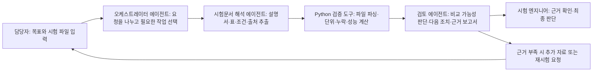
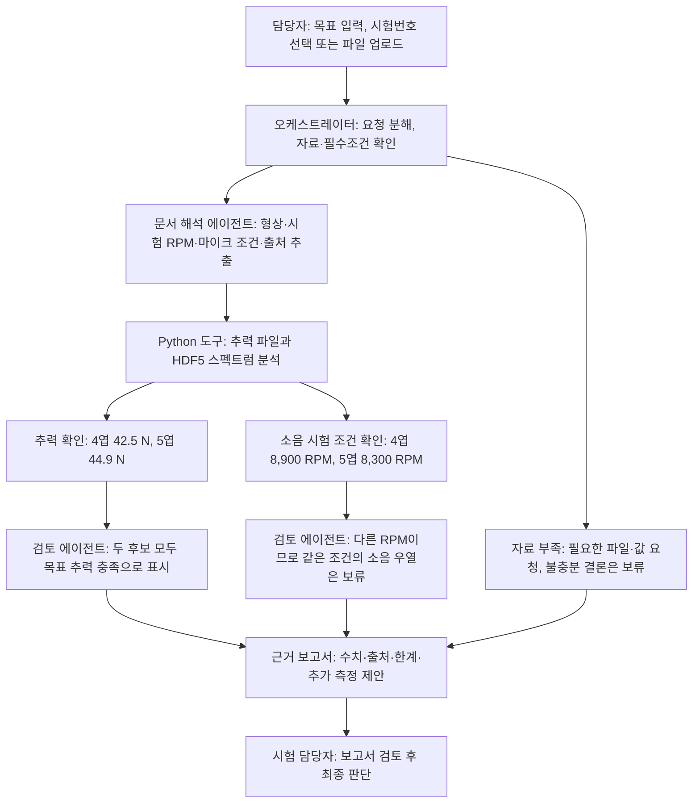

# 항공우주 제조 AI 에이전트 아이디어 제안서

작성일: 2026-09-23
상태: 팀 논의용 초안 

## 아이디어 평가 기준

앞으로 주제, 기능 범위, 구현 우선순위를 정할 때 아래 기준을 함께 사용한다.

1. **현장 문제의 실재성** — 실제 제조 업무의 사용자, 반복 빈도, 시간·비용·품질 손실을 확인했는가?
2. **해결 적합성** — 제안 기능이 확인된 문제를 직접 줄이고 결과를 검증할 수 있는가?
3. **에이전트 배치와 E2E 자동화** — AI 에이전트를 문서 이해, 조건 판단, 작업 분기처럼 사람의 반복적이고 시간이 오래 걸리는 작업에 배치했는가? 계산·단위 변환·규칙 검증은 재현 가능한 도구에 맡겼는가? 입력부터 결과 검토까지 흐름이 이어지는가? 절약되는 사람의 시간·비용이 추론·GPU·연동·검증·운영 비용을 상쇄하는가?
4. **도입 비용 대비 효용** — 데이터 연결, 보안, 운영, 사람의 재검토를 포함한 총비용보다 절감 효과가 큰가?
5. **현장 사용자와 기업의 사용 가능성** — 실제 담당자가 기존 업무와 함께 사용할 이유가 있으며, 도입을 막는 조건을 확인했는가?
6. **비즈니스 가치** — 누가 어떤 비용을 절감하거나 가치를 얻고, 그 효과를 반복해서 측정할 수 있는가?
7. **대회 취지와의 적합성** — 우주항공 제조 AI 에이전트 주제와 대회가 요구하는 작동 흐름에 부합하는가?
8. **심사 매력도** — 실제 동작, 측정 가능한 개선, 근거의 신뢰성, 문제 해결의 명확성이 시연에서 드러나는가?

## 프로젝트 전체 흐름

## 1. 제안

**프로펠러 시제품의 추력·토크·소음 시험 파일과 설명서를 여러 전문 에이전트가 나누어 검토하고, 비교 가능한 데이터만 근거와 함께 정리하는 E2E 시험 검토 시스템**을 만든다. 비교할 근거가 부족하면 억지로 순위를 정하지 않고 `조건부 검토` 또는 `선정 보류`와 필요한 추가 자료를 제시한다.

가칭: **Propeller Evidence Agent**. 목표는 문서 확인, 수치 검증, 보고서 작성에 드는 반복 작업을 자동화해 시험 담당자의 검토 시간과 비용을 줄이는 것이다.

## 2. 왜 필요한가

항공우주 부품은 단순히 “소음 수치가 가장 낮다”는 이유만으로 선택하기 어렵다. 프로펠러 형상에 따라 추력과 소음이 함께 달라지고, 회전속도(RPM), 측정 위치, 시험 방식이 다른 자료는 같은 기준으로 비교할 수 있는지 확인해야 한다. 시험 담당자는 **어떤 부품을 어떤 조건에서 시험했으며, 결론이 어느 파일과 측정값에서 나왔는지** 추적해야 한다.

첫 사용자는 **프로펠러 개발팀의 시험 엔지니어 또는 시험품질 담당자**다. 설계 후보를 검토할 때 시험 설명서와 측정 파일을 대조하고, 조건을 확인하고, 보고서를 정리하는 반복 업무를 돕는다. 핵심 질문은 “목표 추력 조건을 만족하는 후보 중 어떤 자료가 소음 비교를 뒷받침하며, 무엇을 더 측정해야 하는가?”이다.

시험 기록의 추적성과 품질 데이터 검토는 제조·항공우주 분야에서 실제로 다뤄지는 업무다. 다만 이 특정 사용자의 현재 검토 시간과 오류 빈도는 아직 확인되지 않았으므로, 대회 이후 현장 인터뷰와 시간 측정으로 검증한다.

## 3. 제품이 실제로 하는 일

1. 담당자가 목표 조건을 자연어로 입력한다. 예: `추력 40 N 이상인 후보 중 소음이 낮은 쪽을 검토해줘`.
2. 오케스트레이터 에이전트가 목표와 업로드 파일 종류를 파악해 필요한 검토 단계를 선택한다.
3. 시험문서 해석 에이전트가 설명서·PDF·표에서 로터 형상, RPM, 측정 위치, 소음 지표와 출처를 추출하고 근거 위치를 붙인다.
4. Python 도구가 TXT·HDF5 값을 읽고 단위·누락값·목표 추력·토크를 계산한다. **수치와 비교 규칙은 LLM이 추측하지 않는다.**
5. 검토 에이전트가 추출된 조건과 계산 결과를 대조해 비교 가능성, 불확실성, 필요한 다음 조치를 정리한다.
6. 보고서 생성 단계가 원본 파일·측정 조건·계산 결과·한계를 연결한 검토 결과를 만든다.
7. 시험 담당자가 근거를 확인하고 최종 후보 선택을 결정한다.

### 사용 장면 예시

담당자가 4엽·5엽 프로펠러 데이터를 넣고 “최소 추력 40 N을 만족하면서 더 조용한 후보를 검토해줘”라고 요청한다.

이 데이터에서는 두 프로펠러가 각 측정점에서 목표 추력을 넘지만, 소음은 서로 다른 RPM에서 측정됐다. 따라서 시스템은 추력 충족을 표시하되, 같은 조건의 소음 승자를 확정하지 않는다. 추가 비교가 필요하면 동일한 운전·측정 조건의 소음 시험을 요청한다. [eVTOLUTION 데이터와 설명서][evto]

### 에이전트가 실제로 돕는 과정

담당자가 “추력 40 N 이상인 후보 중 소음이 낮은 쪽을 검토해줘”라고 입력하면 다음처럼 개입한다.

| 단계     | 에이전트·도구의 일                                                                | 담당자에게 주는 도움                                                                               |
| ------ | ------------------------------------------------------------------------- | ----------------------------------------------------------------------------------------- |
| 자료 확인  | 오케스트레이터가 요청을 **최소 추력 40 N**과 **소음 비교**로 나누고, 선택한 시험 건에 어떤 파일이 있는지 확인한다.   | 필요한 자료와 현재 빠진 자료를 한눈에 본다. 소음 파일이 없으면 소음 결론은 못 낸다고 알려준다.                                   |
| 조건 추출  | 문서 해석 에이전트가 PDF에서 부품 형상, 시험조건, 측정 위치와 지표 정의를 찾고 페이지·표 위치를 함께 남긴다.         | 설명서를 직접 뒤져 조건을 옮겨 적는 작업을 줄인다. 문서에서 찾지 못한 값은 만들지 않고 **확인 필요**로 표시한다.                       |
| 수치 처리  | Python 도구가 측정 파일을 읽고 추력·토크와 소음 지표를 계산한다.                                  | 큰 파일을 직접 열어 값을 정리하고 계산하는 반복 작업을 맡긴다. 보고서에는 사용한 원본 값과 단위를 남긴다.                             |
| 결과 검토  | 검토 에이전트가 문서에서 읽은 조건과 측정파일의 메타데이터·계산 결과를 대조한다.                             | 이 공개 예시에서는 두 추력 측정값이 각각 40 N을 넘지만, 소음 RPM이 8,900과 8,300으로 달라 동등 조건의 소음 승자는 정할 수 없다고 설명한다. |
| 보고서·결정 | 보고 에이전트가 출처, 계산값, 결론의 범위, 보류 이유와 필요한 추가 시험을 정리한다. 담당자는 근거를 열어 확인한 뒤 결정한다. | 보고서 초안과 근거 모음을 자동으로 받고, 최종 판단에는 집중한다.                                                     |

**파일을 매번 올려야 하는가?** 지금 제안한 MVP에서는 시험 파일을 직접 업로드해야 한다. 실제 현장에서 업로드 부담을 줄이려면 시험 장비가 저장한 기록이나 회사의 시험 데이터 저장소와 연동하고, 담당자가 시험번호만 선택하게 해야 한다. 그런 연결도 업로드도 없으면 시스템에는 분석할 자료가 없으므로, 오케스트레이터는 분석을 멈추고 필요한 파일 목록을 보여준다. 자료가 일부만 있을 때는 가능한 수치만 부분 보고하고, 없는 증거가 필요한 결론은 보류한다.

**TXT와 HDF5는 무엇인가?** TXT는 이 자료에서 RPM·추력·토크가 행별로 적힌 읽기 쉬운 텍스트 표다. HDF5는 큰 수치 배열과 설명 정보를 계층 구조로 저장하는 바이너리 형식이며, 여기에는 마이크 위치별 소음 PSD와 주파수 배열이 들어 있다. Python 라이브러리가 두 형식을 열어 표·배열을 읽고 정해진 계산을 수행한다. LLM이 파일의 숫자를 추측하거나 직접 계산하는 구조가 아니다.

## 4. 에이전트를 적재적소에 배치하는 방법

에이전트는 사람의 시간이 많이 드는 비정형 문서 해석, 자료 대조, 결과 초안 작성에 배치한다. 수치 계산과 고정된 판정 규칙은 Python 도구가 맡는다. 역할이 다른 작업을 실제로 줄일 때만 여러 에이전트로 나눈다.

| 구성요소         | 책임                                              |
| ------------ | ----------------------------------------------- |
| 오케스트레이터 에이전트 | 사용자 목표와 입력 파일을 파악하고 필요한 검토 단계를 선택·연결            |
| 시험문서 해석 에이전트 | 설명서·PDF·표에서 시험조건과 근거 위치를 추출하고 불확실한 항목 표시        |
| 검토·보고 에이전트   | 도구 결과를 대조해 비교 가능성, 보류 사유, 추가 조치를 정리하고 근거 보고서 작성 |
| Python 분석 도구 | TXT·HDF5 파싱, 단위·누락값 검사, 성능 계산, 비교 규칙 적용         |
| 시험 담당자       | 추출 근거와 위험 항목을 검토하고 최종 후보 선택                     |

에이전트가 문서 읽기와 대조·보고를 자동화해 줄인 시간은 모델 추론, H200 사용, 데이터 연동, 검증과 사람의 재검토 비용을 포함해 측정한다. 목적은 사람의 판단을 없애는 것이 아니라, 사람이 오래 붙들던 반복 작업을 줄이고 비용 대비 효용이 있는 E2E 흐름을 만드는 것이다.

오케스트레이터가 모든 항공제조 변수와 예외를 미리 알 수 있다고 가정하지 않는다. MVP에서는 시험 담당자가 확인한 체크리스트와 지원 파일 형식 안에서만 단계를 선택한다. 목록 밖의 상황, 서로 충돌하는 자료, 출처가 약한 추출값은 **미확인**으로 표시하고 자동 순위화를 멈춰 사람에게 넘긴다. 여러 에이전트의 답이 일치해도 그것만으로 정확하다고 간주하지 않는다. 원본 근거, 필수 항목 검사, Python 계산 재현, 승인된 조건 규칙, 담당자의 확인을 거친 결과만 신뢰 범위를 정한다.

모델이 스스로 제시한 확신도만으로 자동 통과시키지도 않는다. 사람이 확인한 표본으로 형상·RPM·마이크 위치 같은 항목별 추출 정확도와 조건 충돌 탐지 성능을 재고, 검증한 파일 형식과 조건 안에서만 자동 처리한다. 새로운 문서 형식이나 예상하지 못한 조건은 담당자 검토로 보낸다.

그래서 현재 제품의 역할은 실제 시험 승인자가 아니라 검토 보조자다. 실제로 쓸 만한지는 같은 시험 건에서 수작업 시간과 에이전트 처리 후 확인 시간을 비교하고, 누락·조건충돌 탐지율, 잘못된 보류·선정 비율, 담당자의 추가 확인 부담까지 측정해야 판단할 수 있다. 사람의 절감 비용에서 모델 추론·H200·데이터 연동·검증 비용을 빼서 순효용을 본다.

## 5. 데이터와 H200 활용

**1차 실측 데이터:** eVTOLUTION 공개 자료에는 4엽·5엽 프로펠러의 RPM·추력·토크 파일, 마이크별 소음 스펙트럼(HDF5), 시험 설명서가 있다. 각 원본의 출처와 버전을 보고서에 연결한다. 소음 스펙트럼은 두 프로펠러의 서로 다른 설계 RPM에서 측정됐으므로, 같은 조건의 소음 우열을 검증하는 데에는 한계가 있다. [eVTOLUTION v1][evto]

**2차 참고 자료:** NASA 소형 로터 시험 보고서의 표·그림·설명문은 문서에서 조건을 추출하는 기능의 참고 자료로 쓴다. 추출 값에 원본 페이지·표·그림 위치를 기록하고, 공개 실험의 결과를 실물 UAM 기체 성능으로 일반화하지 않는다. [NASA 보고서][nasa]

**새 파일 업로드:** 같은 입력 형식의 시험 파일을 추가하면 동일한 파싱·검토 흐름을 실행한다. 공개 데이터와 사용자가 올린 파일은 화면과 보고서에서 출처를 분명하게 구분한다.

**H200 활용:** 대회에서 제공되는 H200 GPU 서버에서 에이전트가 사용하는 언어·비전 모델을 추론 실행한다. 특히 시험 설명서 PDF와 표·그래프에서 시험 조건, 데이터 정의, 근거 위치를 읽고 구조화하는 데 GPU 추론을 사용한다. 검토 에이전트는 구조화된 결과를 받아 다음 도구를 선택하고 보고서 초안을 만든다. 수치 파싱·계산·비교 규칙은 Python 도구로 실행하고, 모델이 추출한 값은 원본 자료와 대조한다. 현재 데이터 규모로 별도의 소음 예측 모델을 학습하기보다 문서 해석과 에이전트 추론에 H200을 사용한다.

## 6. 데모

시연은 실제 파일 입력부터 결과 확인까지 한 번에 실행한다.

1. 사용자가 `추력 40 N 이상인 후보 중 소음이 낮은 쪽을 검토해줘`라고 입력한다.
2. eVTOLUTION의 TXT·HDF5 파일과 시험 설명서를 업로드한다.
3. 오케스트레이터가 시험문서 해석 에이전트를 호출하고, 이어 Python 분석 도구와 검토·보고 에이전트를 연결하는 과정을 화면에 보여준다.
4. **정상 처리:** 실제 추력·토크 파일을 읽어 목표 조건과 측정값을 계산하고 출처가 연결된 보고서를 생성한다.
5. **조건 불일치 처리:** 소음 자료가 4엽 8,900 RPM, 5엽 8,300 RPM에서 측정된 점을 찾아 같은 조건의 소음 순위를 보류하고 필요한 추가 시험을 제시한다.
6. 시험 담당자가 결과의 원본 근거를 열어 확인하고 최종 판단을 내린다.
7. 반복 검토 작업의 수작업 시간과 에이전트 처리 후 확인 시간을 기록해, 절감 효과와 사람의 재검토 부담을 비교한다.

소음 후보를 실제로 순위화하는 장면은 비교 가능한 조건의 측정 자료를 확보한 뒤에만 시연한다. 시연 자료가 합성된 경우에는 실제 측정 데이터와 화면·보고서에서 구분한다.

[evto]: https://zenodo.org/records/17941588
[nasa]: https://ntrs.nasa.gov/citations/20250003316
