## 트리형 작업분할도

```text
요구사항 관리 Slack 봇 개발
├─ 1 요구분석
│  ├─ 1.1 주제·제안서 작성
│  ├─ 1.2 기능 범위·승인 시나리오 분석
│  ├─ 1.3 Slack·CLI 실행 환경 요구분석
│  ├─ 1.4 AI·음성 API 사용 제약 분석
│  ├─ 1.5 요구분석·WBS 중간발표 정리
│  └─ 1.6 요구분석 검토·중간발표 제출
├─ 2 설계
│  ├─ 2.1 시스템 구조·봇·CLI 연결 설계
│  ├─ 2.2 문서 템플릿·저장 구조 설계
│  ├─ 2.3 대화·승인 흐름 설계
│  └─ 2.4 AI 분석·회의·충돌 검사 설계
├─ 3 코딩
│  ├─ 3.1 Slack 대화 수집·종료 감지 구현
│  ├─ 3.2 CLI 연결·로컬 문서 관리 구현
│  ├─ 3.3 AI 요구사항 분석·문서 초안 생성
│  ├─ 3.4 Slack 승인·문서 갱신 통합
│  ├─ 3.5 MP3 회의록·요구사항 처리 구현
│  ├─ 3.6 /conflict 검사·충돌 해결 구현
│  └─ 3.7 재연결·오류·API 비용 관리 구현
└─ 4 테스트
   ├─ 4.1 승인·정보부족 경계 테스트
   ├─ 4.2 사용자 분리·재연결 테스트
   ├─ 4.3 음성·문서 충돌 통합 테스트
   ├─ 4.4 실행 안내·인수 시연 준비
   ├─ 4.5 테스트 결과·최종발표 자료 정리
   └─ 4.6 인수 시연·최종 제출 확인
```

```mermaid
flowchart TB
  root["요구사항 관리 Slack 봇 개발"]
  root --- stage1["1 요구분석"]
  stage1 --- task1_1["1.1 주제·제안서 작성"]
  stage1 --- task1_2["1.2 기능 범위·승인 시나리오 분석"]
  stage1 --- task1_3["1.3 Slack·CLI 실행 환경 요구분석"]
  stage1 --- task1_4["1.4 AI·음성 API 사용 제약 분석"]
  stage1 --- task1_5["1.5 요구분석·WBS 중간발표 정리"]
  stage1 --- task1_6["1.6 요구분석 검토·중간발표 제출"]
  root --- stage2["2 설계"]
  stage2 --- task2_1["2.1 시스템 구조·봇·CLI 연결 설계"]
  stage2 --- task2_2["2.2 문서 템플릿·저장 구조 설계"]
  stage2 --- task2_3["2.3 대화·승인 흐름 설계"]
  stage2 --- task2_4["2.4 AI 분석·회의·충돌 검사 설계"]
  root --- stage3["3 코딩"]
  stage3 --- task3_1["3.1 Slack 대화 수집·종료 감지 구현"]
  stage3 --- task3_2["3.2 CLI 연결·로컬 문서 관리 구현"]
  stage3 --- task3_3["3.3 AI 요구사항 분석·문서 초안 생성"]
  stage3 --- task3_4["3.4 Slack 승인·문서 갱신 통합"]
  stage3 --- task3_5["3.5 MP3 회의록·요구사항 처리 구현"]
  stage3 --- task3_6["3.6 /conflict 검사·충돌 해결 구현"]
  stage3 --- task3_7["3.7 재연결·오류·API 비용 관리 구현"]
  root --- stage4["4 테스트"]
  stage4 --- task4_1["4.1 승인·정보부족 경계 테스트"]
  stage4 --- task4_2["4.2 사용자 분리·재연결 테스트"]
  stage4 --- task4_3["4.3 음성·문서 충돌 통합 테스트"]
  stage4 --- task4_4["4.4 실행 안내·인수 시연 준비"]
  stage4 --- task4_5["4.5 테스트 결과·최종발표 자료 정리"]
  stage4 --- task4_6["4.6 인수 시연·최종 제출 확인"]
```



## 표형 작업분할도

| ID | 선행 작업 ID | 작업 완료도 | 우선순위 | 작업 이름 | 기간 | 시작 날짜 | 완료 날짜 |
|---|---|---:|---|---|---|---|---|
| 1.1 | - | 100% | 낮음 | 주제·제안서 작성 | 미기록 | 미기록 | 미기록 |
| 1.2 | 1.1 | 0% | 높음 | 기능 범위·승인 시나리오 분석 | 2일 | 2026-10-06 | 2026-10-07 |
| 1.3 | 1.1 | 0% | 높음 | Slack·CLI 실행 환경 요구분석 | 2일 | 2026-10-06 | 2026-10-07 |
| 1.4 | 1.1 | 0% | 높음 | AI·음성 API 사용 제약 분석 | 4일 | 2026-10-06 | 2026-10-09 |
| 1.5 | 1.2 | 0% | 높음 | 요구분석·WBS 중간발표 정리 | 2일 | 2026-10-12 | 2026-10-13 |
| 1.6 | 1.5 | 0% | 높음 | 요구분석 검토·중간발표 제출 | 1일 | 2026-10-14 | 2026-10-14 |
| 2.1 | 1.3,1.4 | 0% | 높음 | 시스템 구조·봇·CLI 연결 설계 | 3일 | 2026-10-12 | 2026-10-14 |
| 2.2 | 2.1 | 0% | 보통 | 문서 템플릿·저장 구조 설계 | 2일 | 2026-10-19 | 2026-10-20 |
| 2.3 | 2.1 | 0% | 높음 | 대화·승인 흐름 설계 | 3일 | 2026-10-15 | 2026-10-17 |
| 2.4 | 2.2 | 0% | 높음 | AI 분석·회의·충돌 검사 설계 | 3일 | 2026-10-21 | 2026-10-23 |
| 3.1 | 2.3 | 0% | 높음 | Slack 대화 수집·종료 감지 구현 | 7일 | 2026-10-26 | 2026-11-01 |
| 3.2 | 2.1,2.2 | 0% | 높음 | CLI 연결·로컬 문서 관리 구현 | 14일 | 2026-10-26 | 2026-11-08 |
| 3.3 | 2.4 | 0% | 높음 | AI 요구사항 분석·문서 초안 생성 | 14일 | 2026-10-26 | 2026-11-08 |
| 3.4 | 3.1,3.2,3.3 | 0% | 높음 | Slack 승인·문서 갱신 통합 | 7일 | 2026-11-09 | 2026-11-15 |
| 3.5 | 3.3,3.4 | 0% | 높음 | MP3 회의록·요구사항 처리 구현 | 7일 | 2026-11-16 | 2026-11-22 |
| 3.6 | 3.3,3.4 | 0% | 보통 | /conflict 검사·충돌 해결 구현 | 14일 | 2026-11-16 | 2026-11-29 |
| 3.7 | 3.4,3.5 | 0% | 보통 | 재연결·오류·API 비용 관리 구현 | 7일 | 2026-11-23 | 2026-11-29 |
| 4.1 | 3.4,3.5 | 0% | 높음 | 승인·정보부족 경계 테스트 | 3일 | 2026-11-30 | 2026-12-02 |
| 4.2 | 3.2,3.7 | 0% | 높음 | 사용자 분리·재연결 테스트 | 4일 | 2026-11-30 | 2026-12-03 |
| 4.3 | 3.5,3.6,3.7 | 0% | 보통 | 음성·문서 충돌 통합 테스트 | 6일 | 2026-11-30 | 2026-12-05 |
| 4.4 | 4.1,4.2,4.3 | 0% | 보통 | 실행 안내·인수 시연 준비 | 2일 | 2026-12-07 | 2026-12-08 |
| 4.5 | 4.1,4.2,4.3 | 0% | 낮음 | 테스트 결과·최종발표 자료 정리 | 3일 | 2026-12-07 | 2026-12-09 |
| 4.6 | 4.4,4.5 | 0% | 높음 | 인수 시연·최종 제출 확인 | 3일 | 2026-12-10 | 2026-12-12 |
