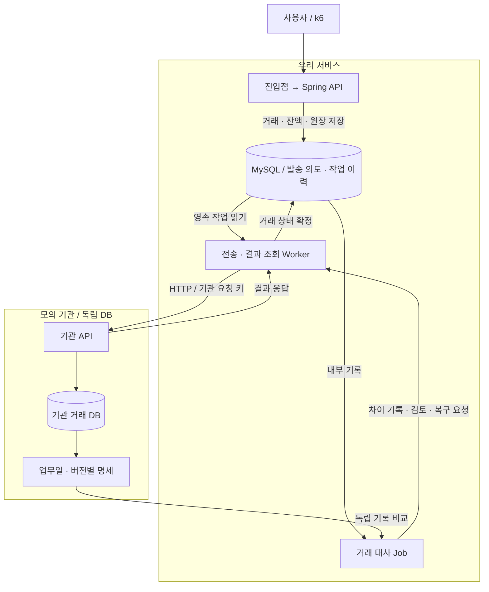
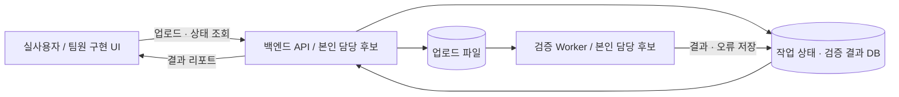

# 김규태 | 금융 백엔드 포트폴리오

> [!note] 2026-10-11 편집 기준 갱신
> 후속 참고 자료: [[ideal 이력서와 포트폴리오 참고 영상 활용 지도]]. 문장 압축·상세 사례·측정 조건·본인 기여 기준을 연결했으며 새 2장/5장 제출본 제작은 별도 작업이다.
> 현재 목표는 **이력서 2장(프로젝트 나열) + 포트폴리오 5장(대표 문제 해결 나열)**이다. 이 문서는 이전 2쪽 압축 초안으로 보존하며 새 문서의 재료로 사용한다. 항목 1~2줄·프로젝트당 약 7줄 등 상세 기준은 [[이력서는 프로젝트 포트폴리오는 문제 해결로 구성한다]]를 참조한다.

> 이상형 편집 원고. 구현·측정·협업 경험을 채운 뒤 제출한다. 아래는 2쪽 배치안이며 실제 PDF 페이지 수는 편집·렌더링 후 확인한다.

## 1쪽 — 개인 프로젝트

**GitHub:** https://github.com/gyutaetae · **연락처:** `[확정]` · **대표 기술 글:** `[글 직접 링크]`

> 편집용 연결: [[2026-10-07-Q-representative-article-detailed-plan]]은 financial-lab 개발·학습 길잡이다. 제출본에서는 이 안내를 삭제하고 대표 글 직접 링크만 남긴다. 집필 목차·학습 계획은 제출본에 넣지 않는다.

### 계좌이체·거래 원장·거래 대사와 복구

**기간/참여:** `[실제 기간]` / 개인 · **기술:** `[실제 사용한 Java·Spring·MySQL·배포 환경]` · **근거:** `[저장소·시연]`

**서비스:** 계좌이체와 원장을 구현하고 별도 모의 기관의 기록을 비교해 미확정 거래·누락·금액 차이를 추적·복구한다.

**예상 트래픽·초기 인프라(가정):** 10만 DAU·30만 이체/일·조회:이체 5:1·피크 15배(313 API RPS/52 이체 TPS)를 기준으로 API 3대(각 2 vCPU/4 GiB)와 MySQL Primary/Standby(각 8 vCPU/32 GiB SSD)를 산정하고 k6로 검증한다.

**전체 아키텍처 `[설계 목표]`:** 실선은 요청·데이터 흐름이다. API·Worker·Job은 책임 구분이며 필수 마이크로서비스 수가 아니다. [상세 구조·장애 시퀀스](거래%20원장%20아키텍처와%20장애%20복구%20설계.md).

### 동시 요청·응답 유실에 따른 잔액 불일치와 중복 이체 방지 `[목표]`

**문제:** 동일 계좌의 동시 요청, 처리 중 실패, 완료 후 응답 유실을 재현한다. 성공 응답·잔액·원장이 일치하는지 확인한다.

**해결:** 경합 제어 방식과 요청 키 처리 방식을 비교한다. 출금·입금·원장을 같은 DB 트랜잭션에서 처리하고 단계별 실패와 중복 재요청을 검증한다. 최종 선택은 `[방식·선택 이유]`로 기입한다.

**결과:** 불일치 `[전 → 후]`, 같은 키 요청 `[N]`건에 실제 반영 `[M]`건, 유효 이체 TPS `[실측]` / p99 `[실측]`. 조건 `[실제 사양·데이터량·집중도·기간]`. 한계 `[확인한 제약]`. 상세 `[대표 글·측정 원본]`.

### 명세 불일치와 배치 중단 후 거래 누락 탐지·복구 `[목표]`

**그림 참조:** 위의 내부 DB·기관 명세→대사 Job→결과 조회·복구 경로. 상세 글에서 누락·금액 차이·미확정의 분기와 재대사를 설명한다.

**문제:** 누락·중복·금액 차이·늦은 결과와 중단 후 재실행을 재현한다. 거래 업무일과 명세 완전성을 확인해 지연을 누락과 구분한다.

**해결:** 거래 처리와 기관 간 결제 일정을 구분하고 명세 버전·영업일·재개 기준을 정의한다. 검증 SQL과 실행계획을 비교하고, 오류 유형별 복구 후 다시 대사한다.

**결과:** 정답 오류 `[N]`건 / 탐지 `[실측]` / 오탐·미탐 `[실측]`, 처리시간 `[전 → 후]`, 재개 후 누락·중복 `[실측]`. 조건 `[데이터량·DB·중단 위치]`. 한계: 합성 명세·모의 기관 검증. 상세 `[SQL·로그·복구 문서]`.

---

## 2쪽 — 협업 프로젝트와 보조 정보

### 업무 데이터 검증·리포트 서비스 `[이상형 후보]`

**기간/팀:** `[실제 기간·구성]` · **역할:** 팀장 + `[직접 책임진 백엔드 모듈]` · **기술:** `[실제 사용 기술]`

**서비스:** 실제 담당자의 반복 업무를 데이터 업로드·검증·결과 조회로 지원한다. 금융 주제는 필수가 아니며 사용자·주제는 선정 전이다.

**담당 범위 목표:** 완료 기준·API 계약·리뷰·통합·릴리스를 조율하고, 작업 상태 API·검증 배치 중 연결된 모듈을 직접 구현한다.

### 요구 변경으로 발생한 화면·API·배치 통합 문제 해결 `[실제 사례로 교체]`

**문제:** `[실제 발견한 현상·원인·사용자 영향]`

**해결:** `[대안과 선택 이유]`를 팀과 합의하고 `[본인 직접 구현]`을 수행한다. `[리뷰로 바뀐 판단]`을 반영하고 팀원 기능과 통합해 배포한다.

**결과:** 업무시간·재작업 `[전 → 후]`, `[본인 코드·PR]`, `[합의·리뷰·사용자 피드백]`. 조건 `[사용자·표본·기간]`. 한계 `[담당 범위·관찰 한계]`.

### 학력·관련 경험·자격·어학

**학력:** `[확인된 학교·SW 전공·졸업 예정일]`

**관련 경험 목표:** 백엔드 개발 인턴·현장실습 1회 + 실사용 협업 서비스의 팀장·핵심 백엔드 구현. `[실제 기간·본인 기여·출시 결과]`

**자격 목표:** 정보처리기사·SQLD · **어학 목표:** TOEIC Speaking IH. `[실제 취득 항목·점수·취득일로 교체]`

취득 후 자격 표기: `정보처리기사 [취득 연월] · SQL 개발자(SQLD) [취득 연월]`. 미취득 항목은 실제 제출본 자격 목록에서 제외한다.

목표는 합격자의 필수 스펙이 아니며 이 계획 원고에만 표시한다. 제출본에는 증빙된 학력·실제 경험·취득 자격·유효 성적만 남긴다. 대표 글·저장소·실험 원본으로 상세 내용을 연결한다. 2쪽 편집 시 핵심 문장과 전체 구조를 우선한다.
