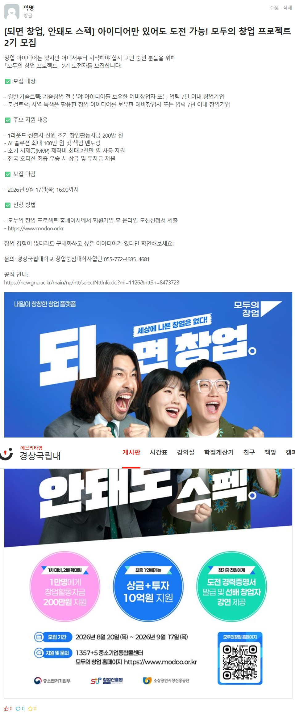
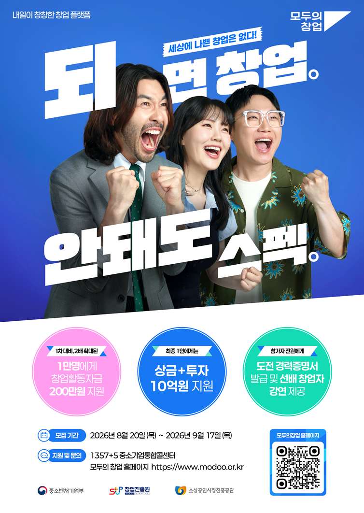
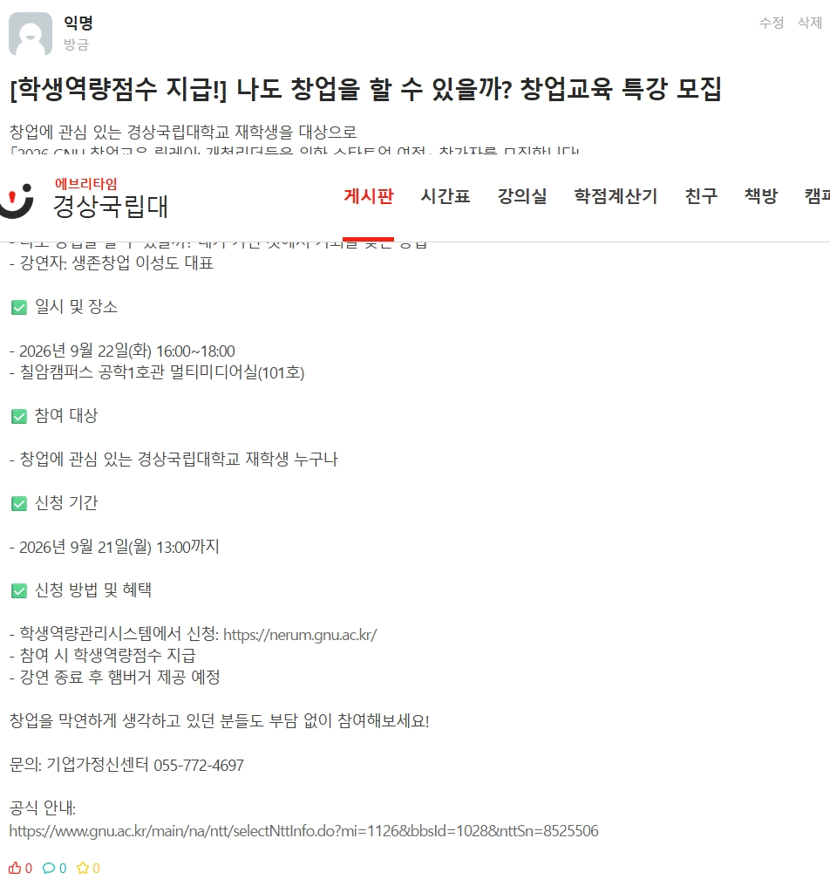
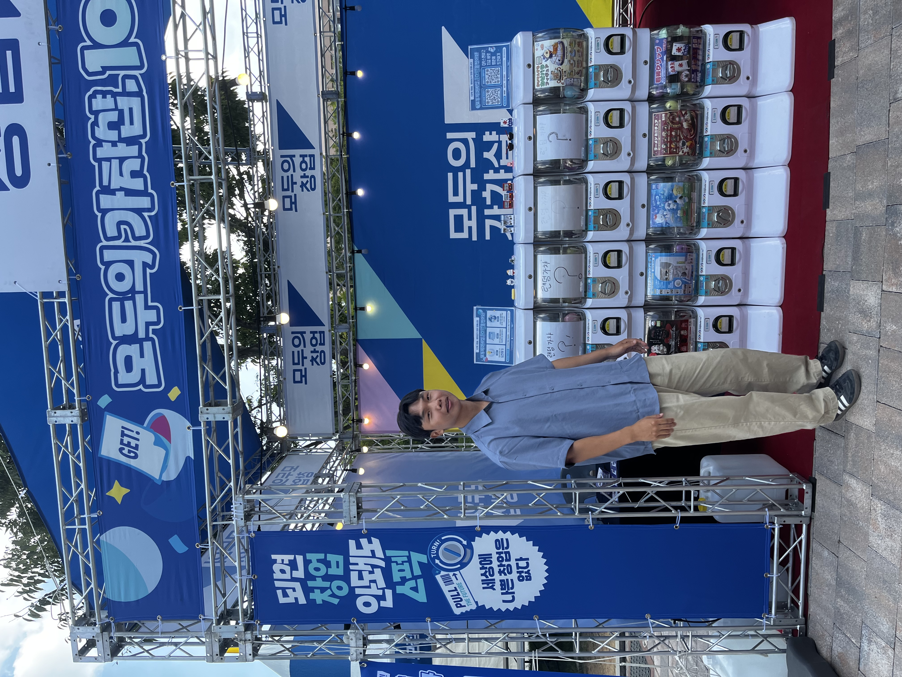

# 2026 GNU 개척리더스 창업서포터즈 홍보 및 활동 기록

이 문서는 온라인 홍보 문구, 게시 채널, 필수 프로그램 참여 현황, 사진 및 활동 증빙을 한곳에 보관하기 위한 기록이다. 활동 종료 후 최종 활동보고서와 성과발표 자료 작성에 활용한다.

## 장학금 목표

| 평가항목 | 배점 | 목표점수 | 준비 방법 |
|---|---:|---:|---|
| 프로그램 필수참여 | 50 | 50 | 인정 프로그램 4회 참여 |
| 프로그램 참여 성실도 | 30 | 28 이상 | 사전 도착, 적극적인 역할 수행, 마감 정리 |
| 프로그램 활동 우수성 | 20 | 17 이상 | 홍보·현장 활동의 구체적인 기록과 증빙 |
| 합계 | 100 | 95 이상 | S등급 60만 원 목표 |

> [!important]
> 프로그램 4회 참여 시 필수참여 점수는 50점 만점이다. 5회 이상 참여에 대한 추가 정량점수는 공고문에 명시되어 있지 않다. 참여 프로그램별 성실도는 산술평균으로 평가되므로, 신청한 프로그램은 취소하지 않고 매번 성실하게 참여하는 것이 중요하다.

## 필수 프로그램 참여 현황

| 번호 | 프로그램 | 일정 | 장소 | 신청 | 참석 | 필수횟수 인정 확인 | 사진 확보 | 비고 |
|---:|---|---|---|---|---|---|---|---|
| 1 | 창업PlayGround | 2026-09-19 16:00~21:00 | 진주 철도문화공원 일원 | 완료 | 확인 필요 | 담당자 확인 필요 | 미확보 | 프로그램 운영지원 |
| 2 | GNU 창업교육 릴레이 1회차 | 2026-09-22 16:00~18:00 | 칠암캠퍼스 공학1호관 멀티미디어실 | 신청 필요 | 예정 | 확인 필요 | 미확보 | 참석자 서명부·햄버거 배부 등 |
| 3 | GNU 창업교육 릴레이 2회차 | 2026-09-30 18:00~20:00 | 가좌캠퍼스 경영대학 105호 | 신청 예정 | 예정 | 확인 필요 | 미확보 | 참석 가능 의사 전달 완료 |
| 4 | GNU 창업교육 릴레이 4회차 | 2026-10-13 16:00~18:00 | 칠암캠퍼스 공학1호관 멀티미디어실 | 신청 필요 | 예정 | 확인 필요 | 미확보 | 3회차는 일정상 참여 불가 |

담당자에게 확인할 문구:

> 안녕하세요. 제 필수 활동 횟수를 정확히 확인하고 싶어 문의드립니다. 창업PlayGround 활동과 창업교육 릴레이 각 회차가 필수 프로그램 참여 횟수에 각각 1회씩 인정되는 것이 맞을까요?

## 홍보 게시 우선순위

### 에브리타임

1. `정보게시판` 또는 교내 정보 성격의 게시판
2. `홍보게시판`이 별도로 있다면 홍보게시판
3. 창업·공모전·대외활동 관련 게시판
4. 자유게시판은 해당 게시판 규칙상 홍보가 허용될 때만 사용

권장 방식:

- 같은 글을 여러 게시판에 동시에 반복 게시하지 않는다.
- 제목 앞에 `[창업지원]`, `[비교과]`, `[경상국립대]`처럼 내용을 표시한다.
- 마감일, 참가 대상, 혜택, 신청 링크를 글 상단에서 바로 확인할 수 있게 작성한다.
- 공식 포스터가 있다면 본문 첫 이미지로 첨부한다.
- 게시 후 작성 시각·조회수·본문이 보이도록 캡처한다.
- 마감일 직전 재홍보는 새 글을 반복 등록하기보다 기존 글을 수정하거나 허용되는 범위에서 한 번만 추가 안내한다.

### 에브리타임 외 추천 채널

| 우선순위 | 채널 | 활용 방법 | 주의사항 |
|---:|---|---|---|
| 1 | 학과·학년 단체채팅방 | 학과 대표 또는 관리자에게 허락을 받고 안내문과 공식 링크 공유 | 무단 광고처럼 보이지 않게 사전 문의 |
| 2 | 창업동아리·중앙동아리 단체방 | 창업·기획·마케팅에 관심 있는 학생에게 공유 | 같은 단체에 중복 전송 금지 |
| 3 | 학생회·단과대 SNS | 카드뉴스 또는 공식 포스터 공유를 요청 | 계정에 직접 게시할 권한이 없다면 관리자에게 요청 |
| 4 | 개인 인스타그램 스토리 | 포스터, 마감일, 신청 링크 스티커를 함께 게시 | 24시간 후 사라지므로 게시 화면 캡처 |
| 5 | 개인 블로그·SNS 피드 | 행사 정보와 추천 대상, 신청 방법을 정리 | 공식 주최자로 오해되지 않게 `서포터즈 홍보`라고 표시 |
| 6 | 교내 창업 관련 오픈채팅방 | 방 규칙을 확인한 뒤 관리자 허락을 받고 공유 | 개인정보 노출 및 무단 홍보 주의 |
| 7 | 강의·동아리 지인에게 직접 전달 | 관심 있을 만한 학생에게 1:1로 링크 공유 | 불특정 다수에게 반복 발송하지 않기 |

학교 공식 홈페이지·공식 인스타그램·학생회 계정에는 직접 게시하지 말고, 담당 관리자에게 공식 포스터와 문구를 전달해 게시를 요청한다.

## 홍보글 1 — 모두의 창업 프로젝트 2기

### 추천 게시판

- 에브리타임 정보게시판 또는 대외활동·공모전 게시판
- 창업동아리 및 학과 단체채팅방
- 개인 인스타그램 스토리

### 제목 후보

1. `[창업지원] 아이디어만 있어도 도전 가능! 모두의 창업 프로젝트 2기 모집`
2. `[9/17 마감] 초기 창업활동자금 지원, 모두의 창업 프로젝트 모집`
3. `[예비창업자 모집] 모두의 창업 프로젝트 2기 도전자 모집`

### 에브리타임 게시용 본문

창업 아이디어는 있지만 어디서부터 시작해야 할지 고민 중인 분들을 위해
「모두의 창업 프로젝트」 2기 도전자를 모집합니다!

✅ 모집 대상

- 일반·기술트랙: 기술창업 전 분야 아이디어를 보유한 예비창업자 또는 업력 7년 이내 창업기업
- 로컬트랙: 지역 특색을 활용한 창업 아이디어를 보유한 예비창업자 또는 업력 7년 이내 창업기업

✅ 주요 지원 내용

- 1라운드 진출자 전원 초기 창업활동자금 200만 원
- AI 솔루션 최대 100만 원 및 책임 멘토링
- 초기 시제품(MVP) 제작비 최대 2천만 원 차등 지원
- 전국 오디션 최종 우승 시 상금 및 투자금 지원

✅ 모집 마감

- 2026년 9월 17일(목) 16:00까지

✅ 신청 방법

- 모두의 창업 프로젝트 홈페이지에서 회원가입 후 온라인 도전신청서 제출
- https://www.modoo.or.kr

창업 경험이 없더라도 구체화하고 싶은 아이디어가 있다면 확인해보세요!

문의: 경상국립대학교 창업중심대학사업단 055-772-4685, 4681

공식 안내:
https://new.gnu.ac.kr/main/na/ntt/selectNttInfo.do?mi=1126&nttSn=8473723

> [!warning]
> 초기 창업활동자금 200만 원은 신청자 전원이 아니라 `1라운드 진출자`에게 지원된다. 표현을 임의로 변경하지 않는다.

### 단체채팅방용 짧은 문구

> 창업 아이디어가 있는 예비창업자·초기 창업기업을 대상으로 「모두의 창업 프로젝트」 2기를 모집한다고 합니다. 1라운드 진출 시 초기 창업활동자금 200만 원과 AI 솔루션·멘토링 등을 지원하며, 신청 마감은 9월 17일(목) 16시입니다. 관심 있는 분은 공식 공고와 신청 자격을 확인해보세요!  
> 신청: https://www.modoo.or.kr  
> 공식 안내: https://new.gnu.ac.kr/main/na/ntt/selectNttInfo.do?mi=1126&nttSn=8473723

## 홍보글 2 — GNU 창업교육 릴레이 1회차

### 추천 게시판

- 에브리타임 정보게시판 또는 비교과·학교생활 게시판
- 경상국립대 학과·학년 단체채팅방
- 창업동아리 및 취업·대외활동 관련 단체방

### 제목 후보

1. `[비교과·햄버거 제공 예정] GNU 창업교육 릴레이 참가자 모집`
2. `[9/22 칠암] 창업이 궁금한 재학생을 위한 무료 특강`
3. `[학생역량점수] 나도 창업을 할 수 있을까? 창업교육 특강 모집`

### 에브리타임 게시용 본문

창업에 관심 있는 경상국립대학교 재학생을 대상으로
「2026 GNU 창업교육 릴레이: 개척리더들을 위한 스타트업 여정」 참가자를 모집합니다!

✅ 강연 주제

- 나도 창업을 할 수 있을까? 내가 가진 것에서 기회를 찾는 방법
- 강연자: 생존창업 이성도 대표

✅ 일시 및 장소

- 2026년 9월 22일(화) 16:00~18:00
- 칠암캠퍼스 공학1호관 멀티미디어실(101호)

✅ 참여 대상

- 창업에 관심 있는 경상국립대학교 재학생 누구나

✅ 신청 기간

- 2026년 9월 21일(월) 13:00까지

✅ 신청 방법 및 혜택

- 학생역량관리시스템에서 신청: https://nerum.gnu.ac.kr/
- 참여 시 학생역량점수 지급
- 운영 안내에 따르면 강연 종료 후 햄버거 제공 예정

창업을 막연하게 생각하고 있던 분들도 부담 없이 참여해보세요!

문의: 기업가정신센터 055-772-4697

공식 안내:
https://www.gnu.ac.kr/main/na/ntt/selectNttInfo.do?mi=1126&bbsId=1028&nttSn=8525506

> [!note]
> 햄버거 제공은 담당자 단체채팅 안내에 따른 내용이며 공식 게시물에는 표시되어 있지 않다. 따라서 `제공 예정`으로 작성한다.

### 단체채팅방용 짧은 문구

> 9월 22일(화) 16시 칠암캠퍼스 공학1호관에서 GNU 창업교육 릴레이 특강이 진행됩니다. 주제는 「나도 창업을 할 수 있을까? 내가 가진 것에서 기회를 찾는 방법」이며 경상국립대 재학생 누구나 신청할 수 있습니다. 학생역량점수가 지급되고, 운영 안내에 따르면 강연 후 햄버거도 제공 예정입니다. 신청 마감은 9월 21일 13시입니다.  
> 신청: https://nerum.gnu.ac.kr/  
> 안내: https://www.gnu.ac.kr/main/na/ntt/selectNttInfo.do?mi=1126&bbsId=1028&nttSn=8525506

## 홍보 실적 기록

홍보를 게시할 때마다 아래 표에 한 줄씩 추가한다.

| 번호 | 게시일시 | 프로그램 | 채널·게시판 | 제목/게시 내용 | 링크 | 조회·반응 | 캡처 파일명 | 비고 |
|---:|---|---|---|---|---|---|---|---|
| 1 | 2026-09-16 13:27경 | 모두의 창업 프로젝트 2기 | 에브리타임 / 정보게시판 | `[되면 창업, 안돼도 스펙] 아이디어만 있어도 도전 가능! 모두의 창업 프로젝트 2기 모집` | 에타 게시물 주소 추가 필요 | 게시 직후 반응 0 / 추후 조회수 확인 필요 | `스크린샷_16-9-2026_132748_everytime.kr.jpeg` | 공식 포스터 첨부 완료 |
| 2 | 2026-09-16 13:32경 | GNU 창업교육 릴레이 1회차 | 에브리타임 / 정보게시판 | `[학생역량점수 지급!] 나도 창업을 할 수 있을까? 창업교육 특강 모집` | 에타 게시물 주소 추가 필요 | 게시 직후 반응 0 / 추후 조회수 확인 필요 | `스크린샷_16-9-2026_13324_everytime.kr.jpeg` | 모집정보와 공식 안내 링크 포함 |
| 3 | 2026-09-__ __:__ |  | 학과·동아리 단체방 / ______ |  | 해당 없음 |  |  |  |

### 2026-09-16 에브리타임 게시 결과

#### 모두의 창업 프로젝트 2기

- 게시 상태: 게시 완료
- 제목: `[되면 창업, 안돼도 스펙] 아이디어만 있어도 도전 가능! 모두의 창업 프로젝트 2기 모집`
- 포함한 핵심정보:
	- 일반·기술트랙과 로컬트랙 모집 대상
	- 1라운드 진출자 초기 창업활동자금 200만 원
	- AI 솔루션·멘토링 및 MVP 제작비 지원
	- 2026-09-17 16:00 모집 마감
	- 신청 홈페이지와 경상국립대학교 공식 안내 링크
- 첨부 이미지: 모두의 창업 공식 포스터
- 증빙 이미지: 
- 원본 포스터: 
- 평가:
	- 지원 조건을 `1라운드 진출자`로 정확하게 표시하여 과장 없이 작성함
	- 마감일·신청 링크·지원 내용을 한 게시물에서 확인할 수 있음
	- 공식 포스터를 함께 첨부하여 정보 신뢰성과 주목도를 높임
- 추가 확보할 증빙:
	- 게시판 이름이 보이는 화면
	- 게시물 고유주소
	- 마감 전 최종 조회수·공감·댓글 화면

#### GNU 창업교육 릴레이 1회차

- 게시 상태: 게시 완료
- 제목: `[학생역량점수 지급!] 나도 창업을 할 수 있을까? 창업교육 특강 모집`
- 포함한 핵심정보:
	- 강연 주제와 강연자
	- 2026-09-22 16:00~18:00 일정
	- 칠암캠퍼스 공학1호관 멀티미디어실(101호)
	- 경상국립대학교 재학생 대상
	- 학생역량관리시스템 신청 링크
	- 학생역량점수 및 햄버거 제공 예정 안내
	- 기업가정신센터 연락처와 공식 안내 링크
- 증빙 이미지: 
- 평가:
	- 제목에 학생역량점수를 표시해 재학생에게 직접적인 참여 동기를 제시함
	- 일정·장소·대상·신청기한·혜택을 빠짐없이 정리함
	- 햄버거를 확정 표현하지 않고 `제공 예정`으로 작성함
- 추가 확보할 증빙:
	- 게시판 이름과 게시물 고유주소
	- 글 상단부터 하단까지 가려지지 않은 전체 화면
	- 모집 마감 전 최종 조회수·공감·댓글 화면

### 홍보 증빙 체크리스트

- [ ] 게시글 제목과 본문 전체가 보이는 캡처
- [ ] 게시 날짜와 시간이 보이는 캡처
- [ ] 조회수 또는 반응이 보이는 캡처
- [ ] 공식 포스터를 첨부한 화면
- [ ] 게시글 주소 또는 게시판 이름 기록
- [ ] 추후 조회수가 증가한 화면 추가 캡처
- [ ] 개인정보와 다른 사람의 이름·프로필 사진을 필요한 만큼 가림

## 활동별 상세 기록

사진과 활동내역을 받으면 아래 양식을 활동별로 복사하여 작성한다.

### 활동 1 — 모두의 창업 2기 홍보부스 마감 지원

- 일시: 2026-09-15 16:40~17:30
- 장소: 가좌캠퍼스 잔디광장
- 활동 구분: 오프라인 홍보 및 운영지원 / 필수 프로그램 횟수 불인정
- 담당 역할: 모두의 창업 2기 홍보부스 마감 및 물품 정리 지원
- 도착·종료 시각: 16:40~17:30
- 함께한 담당자: ______
- 구체적으로 수행한 업무:
	- 모두의 창업 2기 홍보 이벤트 부스 마감 지원
	- 행사 종료 후 부스 운영에 사용한 물품 정리
	- 현장 마감 업무 보조
- 활동 성과:
	- 운영 종료 단계에 현장을 방문하여 50분간 물품 정리와 부스 마감 업무를 지원함
- 현장에서 발생한 문제와 대응:
	- 
- 배운 점:
	- 
- 결과보고서에 강조할 내용:
	- 자발적으로 부스 마감 지원에 참여한 점
	- 필수 프로그램 횟수에는 포함되지 않지만 홍보부스의 원활한 철수와 현장 운영에 기여한 점
- 관련 사진:
	- `KakaoTalk_20260916_133232058.jpg` — 가좌캠퍼스 잔디광장 모두의 창업 홍보부스 앞에서 촬영한 현장 참여 확인 사진



> [!note]
> 이 사진은 행사명과 현장 방문을 확인하는 증빙으로는 좋지만 실제 마감 업무를 수행하는 장면은 아니다. 가능하다면 부스 물품 정리, 현장 정돈 등 실제 활동 장면이나 담당자의 활동 확인 채팅을 추가한다.
- 기타 증빙:
	- 담당자 단체채팅: 프로그램이 아니므로 필수활동 횟수에는 포함되지 않지만 활동결과보고서의 홍보 활동으로 작성할 수 있다는 확인
	- 도착 보고 및 담당자 답변 화면을 별도 캡처할 것

### 활동 2 — 창업PlayGround

- 일시: 2026-09-19 16:00~21:00
- 장소: 진주 철도문화공원 일원
- 활동 구분: 프로그램 운영지원 / 필수횟수 인정 여부 확인 필요
- 담당 역할: ______
- 실제 도착·종료 시각: ______ ~ ______
- 함께한 담당자: ______
- 구체적으로 수행한 업무:
	- 
	- 
- 활동 성과:
	- 
- 현장에서 발생한 문제와 대응:
	- 
- 배운 점:
	- 
- 관련 사진:
	- `[사진 파일명 또는 경로]` — `[사진 설명]`
- 기타 증빙:
	- 

### 활동 3 — GNU 창업교육 릴레이 1회차

- 일시: 2026-09-22 16:00~18:00
- 장소: 칠암캠퍼스 공학1호관 멀티미디어실
- 활동 구분: 프로그램 운영지원 / 필수활동
- 담당 역할: 참석자 서명부 작성, 햄버거 배부, 행사장 정리 등
- 실제 도착·종료 시각: ______ ~ ______
- 함께한 담당자: ______
- 구체적으로 수행한 업무:
	- 
	- 
- 활동 성과:
	- 
- 현장에서 발생한 문제와 대응:
	- 
- 배운 점:
	- 
- 관련 사진:
	- `[사진 파일명 또는 경로]` — `[사진 설명]`
- 기타 증빙:
	- 

### 활동 4 — GNU 창업교육 릴레이 2회차

- 일시: 2026-09-30 18:00~20:00
- 장소: 가좌캠퍼스 경영대학 105호
- 활동 구분: 프로그램 운영지원 / 필수활동
- 담당 역할: 참석자 서명부 작성, 햄버거 배부, 행사장 정리 등
- 실제 도착·종료 시각: ______ ~ ______
- 함께한 담당자: ______
- 구체적으로 수행한 업무:
	- 
	- 
- 활동 성과:
	- 
- 현장에서 발생한 문제와 대응:
	- 
- 배운 점:
	- 
- 관련 사진:
	- `[사진 파일명 또는 경로]` — `[사진 설명]`
- 기타 증빙:
	- 

### 활동 5 — GNU 창업교육 릴레이 4회차

- 일시: 2026-10-13 16:00~18:00
- 장소: 칠암캠퍼스 공학1호관 멀티미디어실
- 활동 구분: 프로그램 운영지원 / 필수활동
- 담당 역할: 참석자 서명부 작성, 햄버거 배부, 행사장 정리 등
- 실제 도착·종료 시각: ______ ~ ______
- 함께한 담당자: ______
- 구체적으로 수행한 업무:
	- 
	- 
- 활동 성과:
	- 
- 현장에서 발생한 문제와 대응:
	- 
- 배운 점:
	- 
- 관련 사진:
	- `[사진 파일명 또는 경로]` — `[사진 설명]`
- 기타 증빙:
	- 

## 새 활동 추가 양식

### 활동 __ — 프로그램명

- 일시:
- 장소:
- 활동 구분: 온라인 홍보 / 오프라인 홍보 / 프로그램 운영지원 / 기타
- 필수횟수 인정 여부:
- 담당 역할:
- 실제 도착·종료 시각:
- 함께한 담당자:
- 구체적으로 수행한 업무:
	- 
	- 
- 활동 성과:
	- 
- 현장에서 발생한 문제와 대응:
	- 
- 배운 점:
	- 
- 결과보고서에 강조할 내용:
	- 
- 관련 사진:
	- `[사진 파일명 또는 경로]` — `[사진 설명]`
- 기타 증빙:
	- 

## 활동 당일 체크리스트

### 활동 전

- [ ] 일정과 장소 재확인
- [ ] 시작 10~15분 전 도착
- [ ] 오픈채팅방에 도착 보고
- [ ] 담당자에게 서포터즈로 왔다고 인사
- [ ] 맡을 역할과 주의사항 확인

### 활동 중

- [ ] 휴대전화 사용 최소화
- [ ] 담당 업무에서 자리를 비우지 않기
- [ ] 맡은 일이 끝나면 추가 업무 질문
- [ ] 참석자에게 친절하게 안내
- [ ] 본인이 실제 업무를 수행하는 사진 촬영 요청

### 활동 종료 전

- [ ] 행사장 및 물품 정리 지원
- [ ] 서명 누락이나 남은 업무 확인
- [ ] 담당자에게 활동 종료 여부 확인
- [ ] 활동 완료 보고
- [ ] 사진과 활동 내용을 당일 기록

## 사진 관리 규칙

권장 폴더 구조:

```text
GNU_창업서포터즈_증빙/
├── 01_온라인홍보/
├── 02_모두의창업_부스지원_2026-09-15/
├── 03_창업PlayGround_2026-09-19/
├── 04_창업교육릴레이1차_2026-09-22/
├── 05_창업교육릴레이2차_2026-09-30/
└── 06_창업교육릴레이4차_2026-10-13/
```

권장 파일명:

```text
2026-09-30_창업교육릴레이2차_서명부관리_01.jpg
2026-09-30_창업교육릴레이2차_햄버거배부_02.jpg
2026-09-30_창업교육릴레이2차_행사장정리_03.jpg
```

사진을 넣을 때 확인할 사항:

- 사진의 날짜와 프로그램명을 기록한다.
- 단순 단체사진보다 실제로 일하는 사진을 우선한다.
- 같은 장면만 여러 장 넣지 않는다.
- 참석자 얼굴·서명부·전화번호 등 개인정보가 노출된 사진은 외부 공개 전에 가린다.
- 원본 사진은 별도 폴더에 보관하고 보고서에는 선별한 사진을 사용한다.

## 결과보고서 작성 재료

최종 보고서에는 다음 흐름으로 정리한다.

1. 활동 목표
	- 창업 프로그램을 학생들에게 홍보하고 프로그램 운영을 지원함
2. 온라인 홍보
	- 게시 채널, 게시 일시, 게시 내용, 조회수와 반응
3. 오프라인 홍보 및 운영지원
	- 프로그램별 역할, 실제 수행 업무, 문제 대응 및 성과
4. 활동 결과
	- 온라인·오프라인 활동 횟수
	- 지원한 프로그램 수와 담당 업무
	- 홍보 반응 또는 참여자 안내 결과
5. 자기평가
	- 잘한 점
	- 아쉬운 점
	- 다음 행사에서 개선할 점
6. 첨부자료
	- 홍보 화면, 현장 활동사진, 담당자 확인 자료

### 자기평가 초안

> 창업서포터즈로서 온라인 홍보와 프로그램 현장 운영지원에 모두 참여하였다. 프로그램 정보를 단순히 전달하는 데 그치지 않고, 대상 학생이 모집 기간·지원 내용·신청 방법을 쉽게 이해할 수 있도록 핵심 내용을 정리하여 홍보하였다. 현장에서는 행사 시작 전에 도착하여 담당 업무를 확인하고, 참석자 서명부 관리와 물품 배부, 행사장 정리 등을 수행하였다. 맡은 업무가 끝난 뒤에도 추가로 필요한 업무를 확인하며 프로그램이 원활히 진행될 수 있도록 지원하였다. 향후에는 게시 채널별 반응을 비교하여 더 효과적인 홍보 방법을 선택하고, 현장 상황을 미리 예상하여 더욱 능동적으로 운영을 지원하고자 한다.

## 앞으로 추가로 확보할 자료

- [ ] 창업PlayGround가 필수활동 1회로 인정된다는 담당자 확인
- [ ] 릴레이 1·2·4회차 신청 완료 화면
- [x] 에브리타임 홍보글 2건의 게시 직후 화면
- [x] 에브리타임 게시판 확인: 정보게시판
- [ ] 에브리타임 게시물 주소·최종 조회수 화면
- [ ] 단체채팅방 또는 SNS 홍보 화면
- [x] 모두의 창업 부스 현장 확인 사진
- [x] 모두의 창업 부스 활동 일시 확인: 2026-09-15 16:40~17:30
- [x] 모두의 창업 부스 업무 확인: 물품 정리 및 현장 마감 지원
- [ ] 모두의 창업 부스 담당자 채팅 캡처
- [ ] 각 프로그램에서 실제 업무를 수행하는 사진
- [ ] 각 활동의 정확한 도착·종료 시각
- [ ] 각 활동에서 맡은 구체적인 역할
- [ ] 현장에서 먼저 해결하거나 추가로 도운 일
- [ ] 프로그램별 배운 점 한두 문장
- [ ] 최종발표 및 성과보고회 일정

## 자료 추가 요청 시 전달 형식

추후 사진과 활동내역을 정리할 때 아래 형식으로 전달한다.

```text
프로그램명:
활동 날짜와 시간:
장소:
도착 시각 / 종료 시각:
맡은 역할:
실제로 한 일:
특별히 추가로 도운 일:
문제 상황과 해결 방법:
느낀 점 또는 배운 점:
사진 파일:
사진마다 무엇을 하는 장면인지:
담당자에게 받은 확인 또는 피드백:
```
