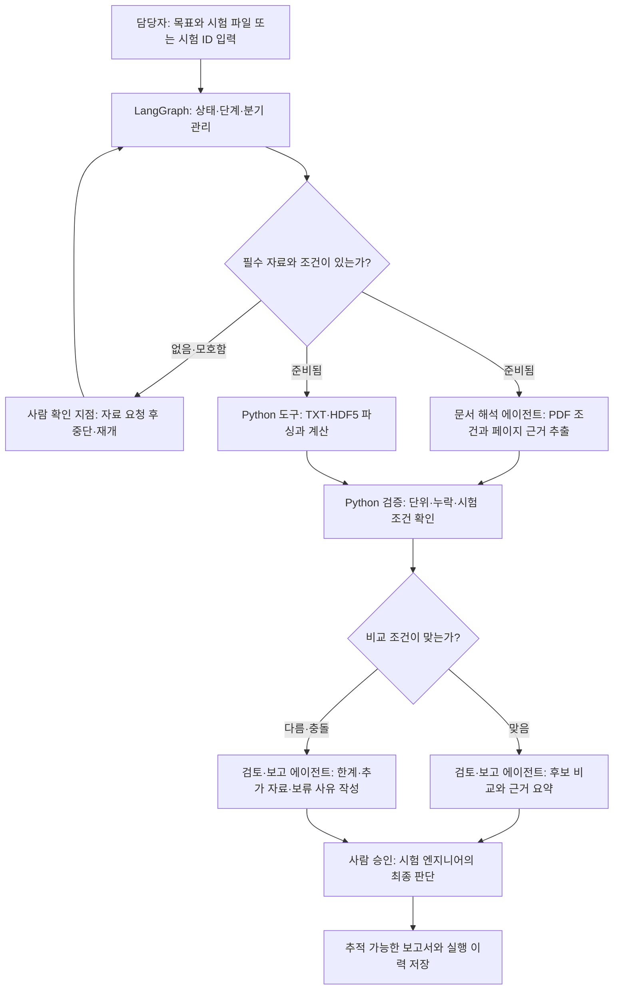
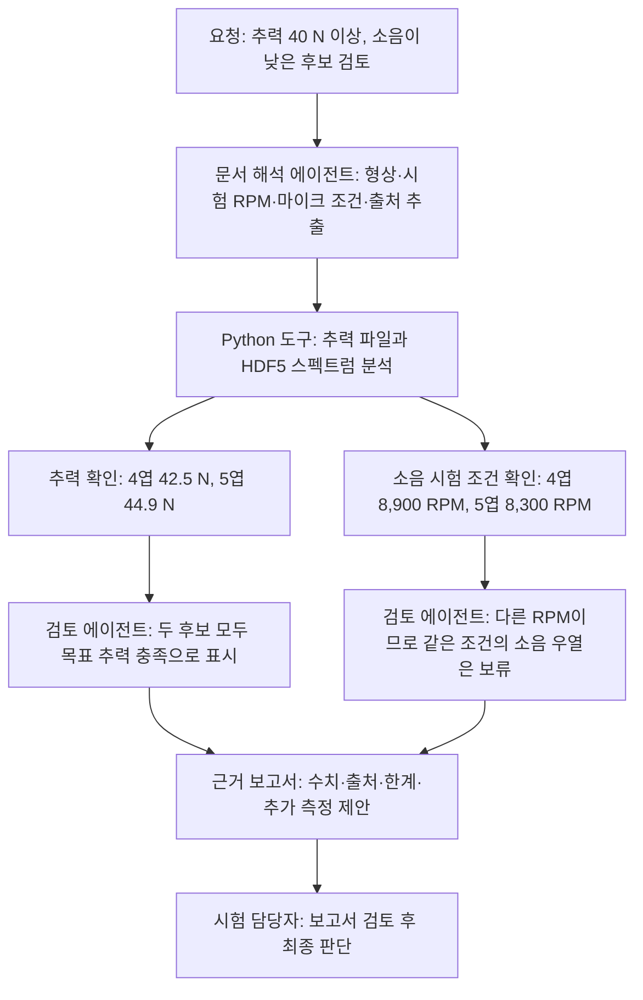

# 항공우주 제조 AI 에이전트 아이디어 제안서

작성일: 2026-09-23
상태: 팀 논의용 초안 — 워크플로우는 LangGraph로 진행하기로 결정

## 기술 선택 결정: LangGraph

**프로젝트의 E2E 워크플로우 오케스트레이션은 LangGraph로 진행한다.** LangGraph는 그 자체가 담당자를 대신해 판단하는 에이전트라기보다, 입력 확인·전문 작업·검증·사람 승인 같은 단계를 상태와 조건 분기로 연결하는 런타임이다. 우리 문제처럼 기본 검토 절차는 정해져 있지만, 자료 누락·조건 불일치·파싱 오류에 따라 멈추거나 사람에게 확인해야 하는 흐름에 적합하다.

선택 근거는 상태를 유지하는 그래프형 실행, 오류나 사람의 응답 뒤 중단 지점에서 재개하는 기능, 실행 단계와 상태를 확인할 수 있는 점이다. 구현 시 에이전트 수를 늘리는 데 목적을 두지 않고, 문서 이해와 근거 검토처럼 언어 판단이 필요한 단계에만 에이전트를 둔다. 자세한 수치 처리와 비교 가능성 게이트는 Python 코드와 명시적 규칙으로 실행한다. [LangGraph 저장소](https://github.com/langchain-ai/langgraph) · [공식 문서](https://docs.langchain.com/oss/python/langgraph/)

### 우리 프로젝트에 적용할 실행 그래프

1. **요청 구조화:** 요청 해석 에이전트가 자연어 요청을 `최소 추력 40 N`, `소음 비교`, `정렬 기준` 같은 구조화된 조건으로 바꾼다. 값·단위가 모호하면 담당자에게 되묻는다.
2. **입력 점검:** 파일 종류와 시험품 ID, 필수 메타데이터를 확인한다. 파일이 없거나 필수 자료가 빠지면 해당 항목을 요청하고 그래프를 멈췄다가 응답 후 재개한다.
3. **독립 작업 병렬 실행:** 문서 해석 에이전트는 PDF에서 형상·시험조건·페이지 근거를 추출하고, Python 파서는 TXT·HDF5에서 원시값과 메타데이터를 읽는다.
4. **결정적 검증:** Python 코드가 단위·누락값·시험품 버전·측정조건을 검사하고, 추력·토크·소음 지표를 계산한다. 조건이 다르면 같은 조건의 후보 순위를 만들지 않고 `비교 불가` 상태를 지정한다.
5. **근거 검토와 보고서 작성:** 검토 에이전트가 구조화된 결과와 인용 근거를 대조해 충돌·한계를 설명한다. 근거가 충분한 부분과 보류한 부분을 분리해 보고서 초안을 만든다.
6. **사람 승인 후 종료:** 그래프가 담당자 검토 지점에서 멈춘다. 담당자가 승인·수정·반려하면 그 응답과 버전을 기록하고 최종 보고서를 저장한다.

그래프 상태에는 시험 ID, 요청 조건, 입력 파일 목록과 해시, 추출 필드와 원본 위치, 파싱 상태, 계산 결과, 비교 가능성, 누락·충돌, 담당자 승인 상태를 보관한다. 따라서 파일 업로드 뒤 끊기거나 담당자 답변을 기다려도 기존 작업을 잃지 않고 이어갈 수 있다.

## 현재 제안 평가

| 평가축                          | 현재 판단                                                                                                                                                                            |
| ---------------------------- | -------------------------------------------------------------------------------------------------------------------------------------------------------------------------------- |
| 제조 현장에서 실제로 겪는 문제인가?         | 시험 결과와 제품 이력의 추적은 실제 제조 품질 업무의 문제다. 다만 “프로펠러 시험 파일이 흩어져 비교가 오래 걸린다”는 구체적인 반복 업무는 현장 인터뷰로 아직 확인하지 않았다. 현재 근거는 문제 분야의 실재를 뒷받침한다(NASA 품질 절차, NIST 제조 데이터 추적성 보고서).                  |
| 제안서가 문제를 해결하는가?              | 조건·단위·누락을 확인하고, 비교가 어려우면 보류하는 검토 보조 도구로는 적합할 가능성이 있다. 현재 공개 자료의 소음 스펙트럼은 4엽 8,900 RPM, 5엽 8,300 RPM에서 측정돼 동등 조건의 소음 우열을 입증하지 못한다. 추력도 각각 42.5 N과 44.9 N으로 다르므로 조건을 보고서에 드러내야 한다. |
| 도입 비용보다 효용이 큰가?              | 공개 데이터 기반 MVP 개발비는 낮게 시작할 수 있지만, 현장 도입 비용과 ROI는 미확인이다. 실제 데이터 형식, 보안, 품질·설계 시스템 연동, 결과 검증 비용을 검토 시간 절감과 재시험 방지 효과에 비교해야 한다.                                                      |
| 일하는 사람이나 기업이 쓸까?             | 시험 엔지니어나 개발품질 담당자의 사전 검토에는 쓸 여지가 있다. 품질 승인 자체를 맡기기에는 근거가 부족하다. 쉬운 자료 입력, 원본까지 추적되는 결과, 기존 절차와의 연결이 사용 가능성을 좌우한다.                                                                 |
| 비즈니스 가치를 제공하는가?              | 자료 취합 시간, 조건 오류, 재검토·재시험 비용을 줄인다는 사업 가설은 있다. 가격이나 구매 의사는 아직 주장하지 않는다. 우선 기존 시험·품질 시스템에 붙이는 검토 기능으로 사용자 반응을 확인한다.                                                                 |
| 에이전트를 적재적소에 붙여 E2E 자동화를 했는가? | LangGraph가 단계와 예외 분기를 통제하고, 문서 해석·요청 해석·근거 설명에만 에이전트를 쓴다. 파일 파싱·계산·고정 규칙은 Python 도구, 최종 승인은 담당자가 맡는다. 시연에서 각 도구·에이전트 호출과 근거가 실제로 이어지는 것을 보여줘야 한다.                                |
| 항공 제조 AI 에이전트 대회 취지와 잘 맞는가?  | 매우 잘 맞는다. 경상국립대 지정과제인 ‘우주항공 제조 AI Agent’에 해당하며, 기능 수보다 에이전트의 문제 해결 과정과 실제 동작을 보여주는 8일 MVP 방향에 적합하다. 주제·신청 안내와 운영 규정은 제출본 확정 전에 다시 확인한다.                                          |
| 심사위원 관점에서 매력적인가?             | 실측 파일 업로드부터 계산·근거 보고서까지의 성공 사례와, 조건 불일치 시 이유·추가 자료를 제시하는 사례를 함께 보여주면 매력적이다. 보류 장면만 보여주면 아무 결론도 못 내리는 제품으로 보일 수 있다. 세부 배점은 설명회에서 공개될 예정이므로 공개 후 데모를 맞춘다.                          |

## 프로젝트 전체 흐름

## 1. 제안

**프로펠러 시제품의 추력·토크·소음 시험 파일과 설명서를 여러 전문 에이전트가 나누어 검토하고, 비교 가능한 데이터만 근거와 함께 정리하는 E2E 시험 검토 시스템**을 만든다. 비교할 근거가 부족하면 억지로 순위를 정하지 않고 `조건부 검토` 또는 `선정 보류`와 필요한 추가 자료를 제시한다.

가칭: **Propeller Evidence Agent**. 목표는 문서 확인, 수치 검증, 보고서 작성에 드는 반복 작업을 자동화해 시험 담당자의 검토 시간과 비용을 줄이는 것이다.

## 2. 왜 필요한가

항공우주 부품은 단순히 “소음 수치가 가장 낮다”는 이유만으로 선택하기 어렵다. 프로펠러 형상에 따라 추력과 소음이 함께 달라지고, 회전속도(RPM), 측정 위치, 시험 방식이 다른 자료는 같은 기준으로 비교할 수 있는지 확인해야 한다. 시험 담당자는 **어떤 부품을 어떤 조건에서 시험했으며, 결론이 어느 파일과 측정값에서 나왔는지** 추적해야 한다.

첫 사용자는 **프로펠러 개발팀의 시험 엔지니어 또는 시험품질 담당자**다. 설계 후보를 검토할 때 시험 설명서와 측정 파일을 대조하고, 조건을 확인하고, 보고서를 정리하는 반복 업무를 돕는다. 핵심 질문은 “목표 추력 조건을 만족하는 후보 중 어떤 자료가 소음 비교를 뒷받침하며, 무엇을 더 측정해야 하는가?”이다.

시험 기록의 추적성과 품질 데이터 검토는 제조·항공우주 분야에서 실제로 다뤄지는 업무다. 

## 3. 제품이 실제로 하는 일

1. 담당자가 목표 조건을 자연어로 입력한다. 예: `추력 40 N 이상인 후보 중 소음이 낮은 쪽을 검토해줘`.
2. LangGraph가 고정된 검토 절차를 시작하고, 요청 해석 에이전트가 목표를 구조화한다. 그래프는 파일 종류·필수조건 점검 결과에 따라 정해진 경로로 분기하며, 에이전트가 임의로 새 절차를 만들게 두지 않는다.
3. 시험문서 해석 에이전트가 설명서·PDF·표에서 로터 형상, RPM, 측정 위치, 소음 지표와 출처를 추출하고 근거 위치를 붙인다.
4. Python 도구가 TXT·HDF5 값을 읽고 단위·누락값·목표 추력·토크를 계산한다. **수치와 비교 규칙은 LLM이 추측하지 않는다.**
5. 검토 에이전트가 추출된 조건과 계산 결과를 대조해 비교 가능성, 불확실성, 필요한 다음 조치를 정리한다.
6. 보고서 생성 단계가 원본 파일·측정 조건·계산 결과·한계를 연결한 검토 결과를 만든다.
7. 시험 담당자가 근거를 확인하고 최종 후보 선택을 결정한다.

### 사용 장면 예시

담당자가 4엽·5엽 프로펠러 데이터를 넣고 “최소 추력 40 N을 만족하면서 더 조용한 후보를 검토해줘”라고 요청한다.

이 데이터에서는 두 프로펠러가 각 측정점에서 목표 추력을 넘지만, 소음은 서로 다른 RPM에서 측정됐다. 따라서 시스템은 추력 충족을 표시하되, 같은 조건의 소음 승자를 확정하지 않는다. 추가 비교가 필요하면 동일한 운전·측정 조건의 소음 시험을 요청한다. [eVTOLUTION 데이터와 설명서][evto]

## 4. 에이전트를 적재적소에 배치하는 방법

에이전트는 사람의 시간이 많이 드는 비정형 문서 해석, 자료 대조, 결과 초안 작성에 배치한다. 수치 계산과 고정된 판정 규칙은 Python 도구가 맡는다. 역할이 다른 작업을 실제로 줄일 때만 여러 에이전트로 나눈다.

LangGraph는 위 구성요소를 연결하고 상태·중단·재개를 관리하는 바깥 워크플로우다. “오케스트레이터 에이전트”가 모든 항공제조 변수를 추론한다고 가정하지 않는다. 팀이 정의한 지원 범위와 검토 체크리스트 안에서 정해진 분기만 실행한다. 체크리스트 밖의 파일 형식, 상충하는 조건, 출처를 확인할 수 없는 값은 담당자 확인으로 보낸다.

| 구성요소         | 책임                                              |
| ------------ | ----------------------------------------------- |
| 오케스트레이터 에이전트 | 사용자 목표와 입력 파일을 파악하고 필요한 검토 단계를 선택·연결            |
| 시험문서 해석 에이전트 | 설명서·PDF·표에서 시험조건과 근거 위치를 추출하고 불확실한 항목 표시        |
| 검토·보고 에이전트   | 도구 결과를 대조해 비교 가능성, 보류 사유, 추가 조치를 정리하고 근거 보고서 작성 |
| Python 분석 도구 | TXT·HDF5 파싱, 단위·누락값 검사, 성능 계산, 비교 규칙 적용         |
| 시험 담당자       | 추출 근거와 위험 항목을 검토하고 최종 후보 선택                     |

에이전트가 문서 읽기와 대조·보고를 자동화해 줄인 시간은 모델 추론, H200 사용, 데이터 연동, 검증과 사람의 재검토 비용을 포함해 측정한다. 목적은 사람의 판단을 없애는 것이 아니라, 사람이 오래 붙들던 반복 작업을 줄이고 비용 대비 효용이 있는 E2E 흐름을 만드는 것이다.

## 5. 데모

시연은 실제 파일 입력부터 결과 확인까지 한 번에 실행한다.

1. 사용자가 `추력 40 N 이상인 후보 중 소음이 낮은 쪽을 검토해줘`라고 입력한다.
2. eVTOLUTION의 TXT·HDF5 파일과 시험 설명서를 업로드한다.
3. 오케스트레이터가 시험문서 해석 에이전트를 호출하고, 이어 Python 분석 도구와 검토·보고 에이전트를 연결하는 과정을 화면에 보여준다.
4. **정상 처리:** 실제 추력·토크 파일을 읽어 목표 조건과 측정값을 계산하고 출처가 연결된 보고서를 생성한다.
5. **조건 불일치 처리:** 소음 자료가 4엽 8,900 RPM, 5엽 8,300 RPM에서 측정된 점을 찾아 같은 조건의 소음 순위를 보류하고 필요한 추가 시험을 제시한다.
6. 시험 담당자가 결과의 원본 근거를 열어 확인하고 최종 판단을 내린다.
7. 반복 검토 작업의 수작업 시간과 에이전트 처리 후 확인 시간을 기록해, 절감 효과와 사람의 재검토 부담을 비교한다.
